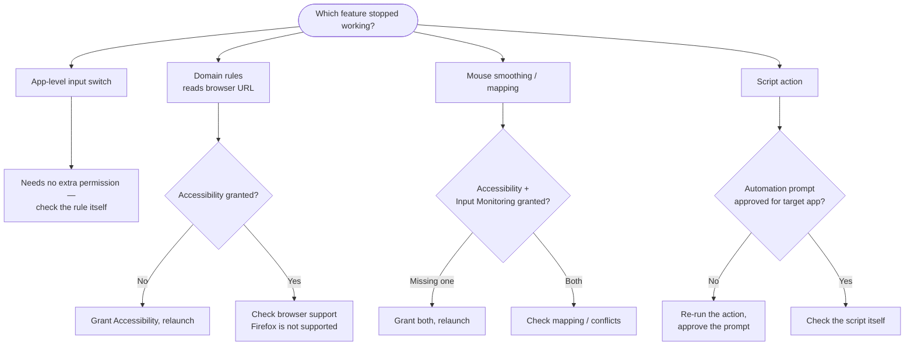

LinguaX depends on macOS permissions for accurate context detection and automation.

## Common symptoms

- input source does not switch after app change
- domain rules are inconsistent in browsers
- shortcut script actions fail on first run

LinguaX uses exactly two macOS permissions:

## Required permissions

- `Accessibility` (used for the mouse event tap, smooth scrolling, pointer speed, key simulation, and reading the front browser tab URL for website rules)
- `Input Monitoring` (used for HID device management)

> App-level input switching works without Accessibility; reading the browser URL for **website** (domain) rules requires Accessibility.

## Required checks

1. Open LinguaX permission status.
2. Open macOS **System Settings** and verify requested permissions are enabled.
3. Relaunch LinguaX after permission changes.

## macOS 27.3 beta 2

macOS 27.3 beta 2 changes how some high-trust permissions are presented. Apple split the former **Device Control and Data Access** setting into **System & App Protection Override** and **Accessibility**, and can now limit access to selected apps or ask for approval each time. Existing permissions remain in effect, but new installations and new permission requests may use the updated flow. See the [macOS 27.3 beta 2 release notes](https://developer.apple.com/documentation/macos-release-notes/macos-27_3-release-notes).

LinguaX does not require Full Disk Access. Do not grant full-disk access to resolve a mouse, browser-context, or input-source issue. If macOS shows **System & App Protection Override** for an operation, grant LinguaX only the target app access required by that workflow.

If a feature stops working on the beta, check the permission that matches the symptom:

1. In **System Settings → Privacy & Security**, check **Accessibility** for mouse actions and website rules, and **Input Monitoring** for HID device access.
2. If LinguaX is missing from the relevant list and the pane offers **+**, add the installed **LinguaX.app**. LinguaX runs these features in a single app process. If macOS directs you to **System & App Protection Override** for a cross-app action, select the target app if macOS offers that choice.
3. Quit and reopen LinguaX, then retry the affected action.

Browser and script actions can also have separate Automation prompts for the target app. For the Logitech comparison and what has been confirmed on beta 2, see the [macOS 27.3 permissions blog post](/blog/macos-27-3-permissions-linguax).

## About script action prompts

When script actions control apps (for example System Events or Finder), macOS may ask for Automation permission.

Approve these prompts to enable those actions.

## Recovery flow

1. Quit LinguaX.
2. Reopen LinguaX.
3. Re-grant missing permissions.
4. Test one app rule.
5. Test one domain rule.
6. If using script actions, run one template script again.

## Post-update note

Recent versions include storage architecture upgrades. On first launch after upgrade, migration may take extra time before all features behave normally.

## Related docs

- [First Run](/docs/getting-started/first-run)
- [Mouse Issues](/docs/troubleshooting/mouse-issues)
- [Common Issues](/docs/troubleshooting/common-issues)
- [Shortcut and Hotkeys](/docs/concepts/shortcut-and-hotkeys)
