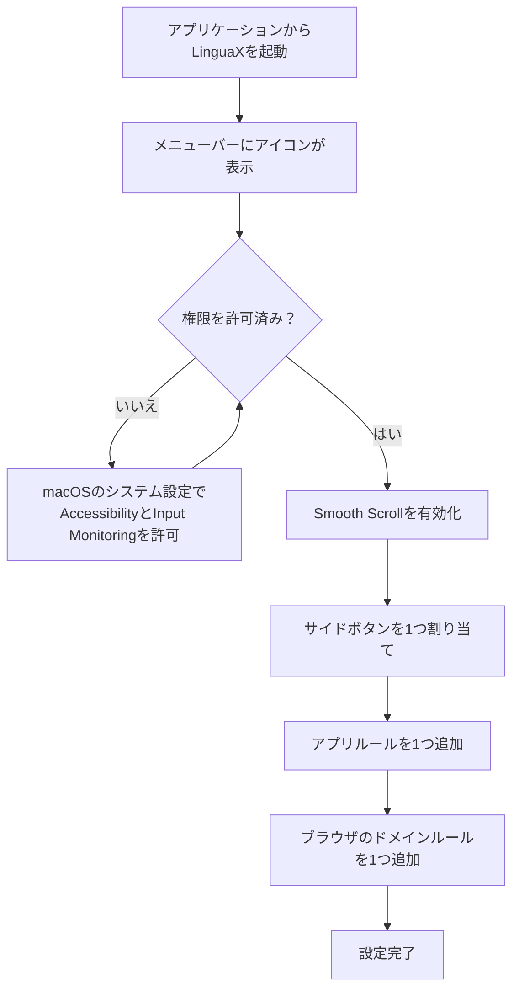

import ThemedImage from '@theme/ThemedImage';
import useBaseUrl from '@docusaurus/useBaseUrl';

インストール後、数分で基本設定を済ませます。まずは必要な機能を1つずつ確認しましょう。

## 初回設定の流れ {#the-first-run-flow-at-a-glance}

以下の5つの手順で、それぞれを設定します。

## 手順1：起動する {#step-1-launch}

1. **アプリケーション**フォルダからLinguaXを開きます。
2. メニューバーにアイコンが表示されることを確認します。

<ThemedImage
  alt={"macOSのメニューバーで、バッテリー、Wi-Fi、コントロールセンター、時計の隣に表示されるLinguaXのマウスアイコン"}
  sources={{
    light: useBaseUrl('/img/linguax-menubar-icon.svg'),
    dark: useBaseUrl('/img/linguax-menubar-icon-dark.svg'),
  }}
  width="720"
/>

## 手順2：権限を許可する {#step-2-grant-permissions}

1. LinguaXの**Settings**で**Permission: Accessibility**と**Permission: Input Monitoring**を選びます。
2. 対応するmacOSのシステム設定が開くので、LinguaXをオンにします。
3. LinguaXに戻り、両方の項目にチェックが付いていることを確認します。

Accessibility（アクセシビリティ）はマウス機能やWebサイトのドメイン検出に、Input Monitoring（入力監視）はHIDデバイスの管理に使います。アプリ単位の入力ソース切り替えにはAccessibilityは不要です。

<ThemedImage
  alt={"LinguaXのSettings画面でPermission: AccessibilityとPermission: Input Monitoringが許可済みの状態。各項目からmacOSの対応する設定画面を開けます"}
  sources={{
    light: useBaseUrl('/img/linguax-mouse-permission.png'),
    dark: useBaseUrl('/img/linguax-mouse-permission-dark.png'),
  }}
  width="420"
/>

## 手順3：Mouse+を1つ試す {#step-3-start-with-one-mouse-win}

1. **Smooth Scroll**を有効にします。
2. 普段使う操作をマウスボタンに1つ割り当てます。
3. よく使うアプリでポインタとスクロールの動作を確認します。

<ThemedImage
  alt={"接続中のデバイスと、クリックして設定できるボタン図を表示するLinguaX Mouse+画面"}
  sources={{
    light: useBaseUrl('/img/linguax-mouse-gesture-mapping.png'),
    dark: useBaseUrl('/img/linguax-mouse-gesture-mapping-dark.png'),
  }}
  width="420"
/>

## 手順4：動作を確認する {#step-4-verify}

1. メインのエディタ用にアプリルールを1つ追加します。
2. ブラウザのドメインルールを1つ追加します。
3. アプリやWebサイトを切り替え、入力ソースが意図どおりに変わることを確認します。

<ThemedImage
  alt={"LinguaXのアプリ別入力ソースルール画面"}
  sources={{
    light: useBaseUrl('/img/linguax-input-method-app-mapping.png'),
    dark: useBaseUrl('/img/linguax-input-method-app-mapping-dark.png'),
  }}
  width="420"
/>

## 手順5：必要に応じて追加する {#step-5-optional-feature-checks}

- 便利そうなら、マウスの割り当てをもう1つ追加します。
- スクリプトアクションを使う場合は、組み込みテンプレートを1つ実行し、macOSのオートメーション許可が表示されたら承認します。

## 次に読む {#next-reading}

- [クイックツアー](/ja/docs/getting-started/quick-tour)
- [Mouse+の概要](/ja/docs/mouse-plus/overview)
- [アプリとWebサイトのルール](/ja/docs/input-source/app-and-website-rules)
- [よくある問題](/ja/docs/troubleshooting/common-issues)
