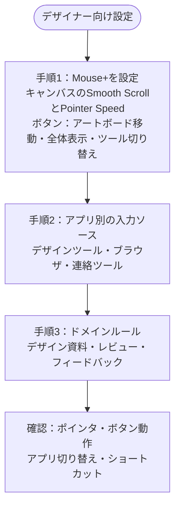

安定したポインタ操作とショートカットが必要な制作作業向けの設定です。まずMouse+でスクロールやポインタの感触を整え、その後で入力ソースのルールを追加します。

## 手順1：Mouse+を設定する {#step-1-mouse-focus}

使い心地に直結する設定から始めます。

1. キャンバス、レイヤー一覧、長いボードで**Smooth Scroll**を試します。
2. **Feel Adjustment → Pointer Speed**で操作しやすい速度に調整します。ハードウェアDPIの設定とは別です。
3. よく使うデザイン操作をマウスボタンに割り当てます。例：
   - アートボードや画面の間で戻る・進む
   - 全体表示へのズームや、頻繁に使うツールの切り替え
   - デザインアプリと参考資料のSpaceを切り替える

チルトホイール搭載マウスでは、`WL` / `WR`にも操作を割り当てられます。

## 手順2：アプリ別の入力ソース {#step-2-app-input-source-rules}

ポインタの感触が整ったら、次のアプリにルールを追加します。

- メインのデザインツール
- ブラウザ
- 連絡・レビューツール

最初は既定値をシンプルにし、必要に応じて細かく設定します。

## 手順3：最初に追加するドメインルール {#step-3-domain-rules-to-add-first}

- デザインのドキュメント
- 社内レビューツール
- フィードバック用プラットフォーム

## 動作確認 {#validation-checklist}

1. デザインアプリでポインタとスクロールが安定していることを確認します。
2. マウスボタンを押し、割り当てた操作が実行されることを確認します。
3. デザインアプリとブラウザを切り替えます。
4. それぞれの入力ソースとショートカットが意図どおりに動くことを確認します。

## 関連ドキュメント {#related-docs}

- [Mouse+の概要](/ja/docs/mouse-plus/overview)
- [ポインタ速度](/ja/docs/mouse-plus/fundamentals/pointer-speed)
- [アプリとWebサイトのルール](/ja/docs/input-source/app-and-website-rules)
- [よくある問題](/ja/docs/troubleshooting/common-issues)
