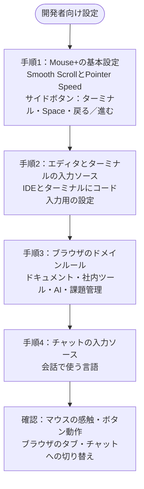

エディタ、ターミナル、ブラウザ、チャットを行き来する開発作業向けの設定です。まずMouse+から整えます。毎日繰り返す移動やスクロール、ボタン操作を快適にしてから、入力ソースのルールを追加しましょう。

## 手順1：Mouse+の基本設定 {#step-1-mouse-foundation}

最初にマウスを設定します。

1. **Smooth Scroll**を有効にし、コードや長い文書を読みやすくします。
2. **Feel Adjustment → Pointer Speed**で快適な速度を選びます。この値はmacOSのポインタ応答を調整するもので、ハードウェアDPIとは別です。
3. サイドボタンに、よく使う開発操作を割り当てます。例：
   - ターミナルを開く
   - Spaceを左右に切り替える
   - ブラウザやエディタの履歴で戻る・進む

チルトホイール搭載マウスでは、`WL` / `WR`にもSpace切り替えなどを割り当てられます。

## 手順2：エディタとターミナルの入力ソース {#step-2-editor--terminal-input-source}

マウスの操作感が整ったら、常用アプリの入力ソースを設定します。

1. エディタ・IDE → コード入力用の入力ソース（通常は英数）。
2. ターミナル → コード入力用の入力ソース。

アプリに切り替えた直後から、そのままコードやコマンドを入力できます。

## 手順3：ブラウザのドメインルール {#step-3-browser-domain-rules}

ドキュメントやツールのドメインごとに設定を追加します。

まずは毎日何度も開くサイトから始めます。

- ドキュメントサイト
- 社内ツール
- AIアシスタント
- 課題管理・コードレビューシステム

## 手順4：チャットの入力ソース {#step-4-chat-app-input-source}

チャットアプリには、普段の会話で使う言語の入力ソースを割り当てます。

## 動作確認 {#validation-loop}

1. IDE、ターミナル、ブラウザでマウスの動作が安定していることを確認します。
2. サイドボタンを押し、割り当てた操作が実行されることを確認します。
3. ブラウザで設定済みの2つのドメインを切り替えます。
4. ブラウザとチャットを切り替え、入力ソースを確認します。

## 設定を保つコツ {#maintenance-guidance}

- 重複・競合するルールを作らない
- ドメインルールは対象を明確にする
- 使わなくなったルールを定期的に整理する

## 関連ドキュメント {#related-docs}

- [Mouse+の概要](/ja/docs/mouse-plus/overview)
- [アプリとWebサイトのルール](/ja/docs/input-source/app-and-website-rules)
- [多言語ワークフロー](/ja/docs/input-source/multilingual-workflow)
- [よくある問題](/ja/docs/troubleshooting/common-issues)
