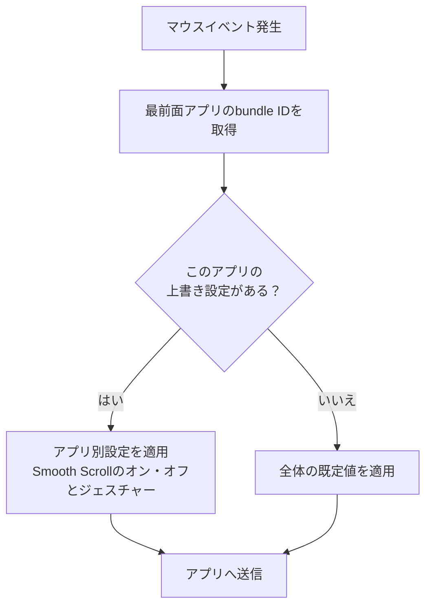

import ThemedImage from '@theme/ThemedImage';
import useBaseUrl from '@docusaurus/useBaseUrl';

# アプリ別の上書き設定 {#app-scoped-overrides}

ブラウザで快適なスクロールが、Xcodeにも合うとは限りません。エディタで使いたいジェスチャーを、ほかのアプリでは変えたいこともあります。全体の既定値を基本にしつつ、必要なアプリだけ動作を上書きできます。

## アプリごとに変更できる設定 {#what-you-can-override-per-app}

- **Smooth Scrollのオン・オフ** — 有効・無効をアプリ別に設定できます。Min Step、Speed Gain、Durationとスクロール方向の反転は全体共通です。
- **ジェスチャー** — Click、Long Press、方向別ドラッグなどの操作を、全体設定とは別に割り当てられます。ボタンのClickアクションも、このジェスチャー設定で上書きします。

スクロールの3パラメータと反転方向は、すべてのアプリで共通です。**Pointer Speed**はアプリ別ではなくデバイス別に保存されます。

<ThemedImage
  alt={"LinguaXのマウス設定。Globalと、Chrome・Finder・WeChatなどのアプリ別タブが同じ行に並びます"}
  sources={{
    light: useBaseUrl('/img/linguax-mouse-settings.png'),
    dark: useBaseUrl('/img/linguax-mouse-settings-dark.png'),
  }}
  width="420"
/>

## 設定手順 {#configuration-steps}

1. Mouse+で対象アプリを選ぶ切り替え欄を開きます。
2. 設定したいアプリを選びます。起動中アプリの一覧は、起動・終了に合わせて自動更新されます。
3. そのアプリの**Smooth Scroll**を切り替えるか、ジェスチャーを設定します。
4. 設定しないアプリには全体の既定値が適用されます。

上書きは、全体設定だけでは使いにくいアプリに絞ると管理しやすくなります。全体設定との優先順位は、[ルールと優先順位](/ja/docs/concepts/rules-and-priority)をご覧ください。

## 関連ドキュメント {#related-docs}

- [Mouse+の概要](/ja/docs/mouse-plus/overview)
- [ルールと優先順位](/ja/docs/concepts/rules-and-priority)
