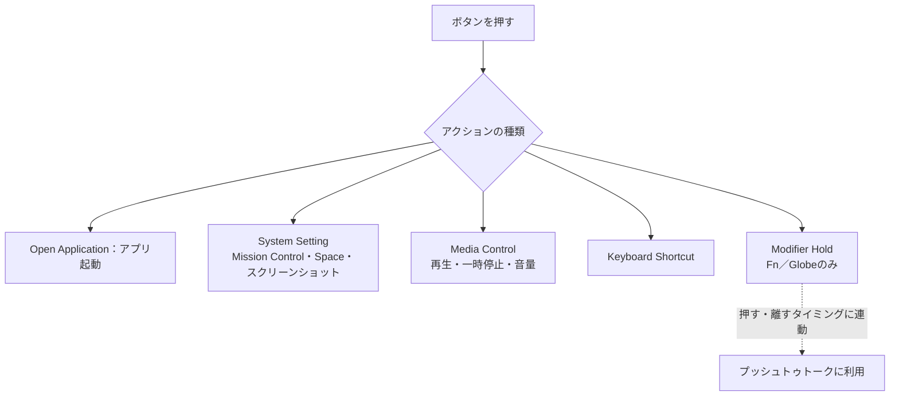

import ThemedImage from '@theme/ThemedImage';
import useBaseUrl from '@docusaurus/useBaseUrl';

# ボタンとサイドボタンの割り当て {#button--side-button-mapping}

Mouse+では、マウスの追加ボタンを、戻る・進む、アプリ起動、ウインドウ操作、メディア操作、記録したショートカットなどに割り当てられます。

## 設定できるボタン {#mappable-buttons}

機種に応じて、次の名前付きスロットが表示されます。

- `Left Button` / `Right Button` — 左右の主ボタン。表示されますが、変更できません。
- `Middle` — 中ボタン。
- `Side 1`–`Side 4` — サイドボタン。
- `Wheel Tilt Left` / `Wheel Tilt Right`（`WL` / `WR`）— ホイールを左右に傾ける水平スクロール入力。
- `Scroll Mode`（`SM`）— 対応するMX Master・MX Anywhereのスクロールモードボタン。
- `Thumb`（`T`）— MX Masterなどの親指ボタン。MX Anywhereにはこの物理ボタンがありません。
- `Thumb`や`Extra 1`–`Extra 5`などの追加スロット — 機種により対応する物理ボタンが異なります。Lift、POP Mouse、MX Master 4などの位置は機種別ガイドをご覧ください。

認識対象のマウスでは、検出後にサイドボタンへ既定の割り当てが適用されます。

## アクションの種類 {#action-types}

設定可能なマウスボタンやジェスチャーには、次の5種類を割り当てられます。

- **Open Application** — 指定したアプリを開きます。
- **System Setting** — ウインドウ操作、Mission Control、Switch Space Left/Right、コントロールセンター、通知センター、スクリーンショット、Finder操作、開発向け操作など。
- **Media Control** — 再生・一時停止や音量などのメディア操作。
- **Keyboard Shortcut** — 内蔵レコーダーで、単独キーやシステム予約キーを含むキー操作を記録します。
- **Modifier Hold** — ボタンを押している間、Fn（Globe）を押した状態にします。

<ThemedImage
  alt={"LinguaXのマウス設定。Globalとアプリ別の切り替え、ボタンの選択、TのClickにLaunchpadを割り当てた例"}
  sources={{
    light: useBaseUrl('/img/linguax-mouse-settings.png'),
    dark: useBaseUrl('/img/linguax-mouse-settings-dark.png'),
  }}
  width="420"
/>

AppleScriptを使うカスタムアクションは、[ショートカットとホットキー](/ja/docs/concepts/shortcut-and-hotkeys)をご覧ください。

## Modifier Hold {#modifier-hold}

**Modifier Hold**は、ボタンを押している間だけ**Fn（Globe）**を押した状態にし、離すと解除します。選べる修飾キーはFnのみです。macOSの音声入力など、キーを押している間だけ動作するツールに利用できます。LinguaX自体が録音する機能ではなく、修飾キーの状態を送る仕組みです。[マウスボタンでプッシュトゥトーク音声入力](/ja/docs/push-to-talk/push-to-talk-voice-typing-mac)をご覧ください。

## 関連ドキュメント {#related-docs}

- [macOSでサイドボタンを割り当てる](/ja/docs/mouse-plus/recipes/map-mouse-side-buttons-macos)
- [ジェスチャーの割り当て](/ja/docs/mouse-plus/fundamentals/gesture-mapping)
