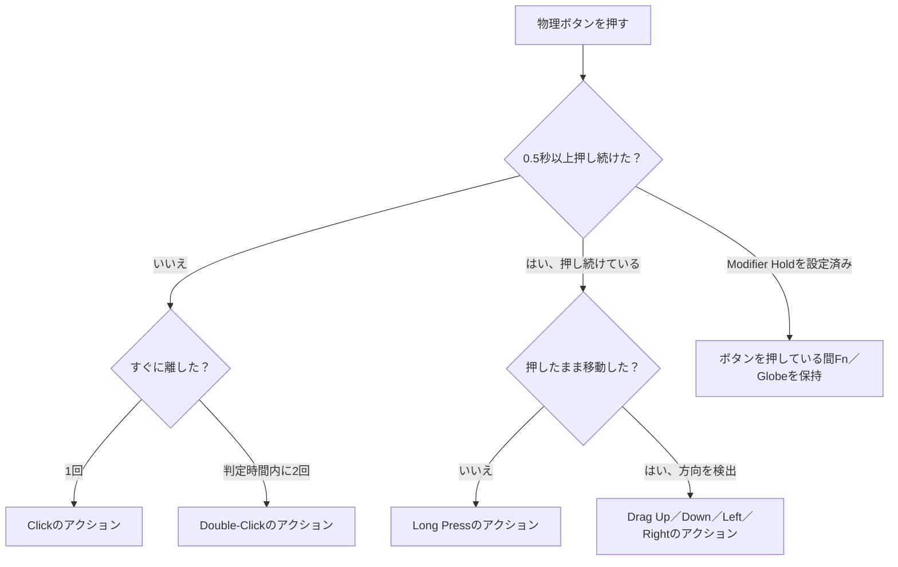

import ThemedImage from '@theme/ThemedImage';
import useBaseUrl from '@docusaurus/useBaseUrl';

# ジェスチャーの割り当て {#gesture-mapping}

1つのボタンに複数の役割を持たせられます。Mouse+は同じボタンで異なるジェスチャーを認識し、それぞれに別の操作を割り当てます。

## ジェスチャーの種類 {#gesture-types}

- **Click** — 1回押します。
- **Double-Click** — 2回押します。システム設定に合わせた間隔で認識します。
- **Long Press** — 0.5秒以上押し続けると、別の操作を実行します。`Thumb`（`T`）スロットの長押しは、Logitech HID++対応デバイスのみで使えます。
- **Drag Up / Drag Down / Drag Left / Drag Right** — ボタンを押したまま上下左右に動かします。4方向に別々の操作を割り当てられます。
- **Modifier Hold** — ボタンを押している間、Fn（Globe）を押した状態にします。

<ThemedImage
  alt={"LinguaXのSide 2のジェスチャー選択。同じボタンにClick、Double-Click、上下左右のDrag、Long Press、Modifier Holdを設定できます"}
  sources={{
    light: useBaseUrl('/img/linguax-mouse-gesture-mapping.png'),
    dark: useBaseUrl('/img/linguax-mouse-gesture-mapping-dark.png'),
  }}
  width="420"
/>

方向別ドラッグ（スワイプ）は、**Release**（離したとき）、**Threshold**（しきい値到達時）、**Interval**（一定間隔）の3モードから選べます。操作中は画面にモード表示が出ます。サイドボタン、長押し、ジェスチャーは共通の実行処理を使います。ホイールチルトの`WL` / `WR`スロットは**Clickのみ**に対応します。

## アクションを割り当てる {#binding-actions}

各ジェスチャーには、**Open Application**、**System Setting**、**Media Control**、**Keyboard Shortcut**、**Modifier Hold**を割り当てられます。たとえば、同じボタンに「クリックで戻る」「長押しでMission Control」「左右ドラッグでSpace切り替え」を設定できます。

## Modifier Holdジェスチャー {#modifier-hold-gesture}

ボタンを押している間は**Fn（Globe）**を保持し、離した瞬間に解除します。プッシュトゥトーク音声入力など、押している間だけ有効にしたいツールで使えます。選べる修飾キーはFnのみです。

## 関連ドキュメント {#related-docs}

- [ボタンとサイドボタンの割り当て](/ja/docs/mouse-plus/fundamentals/button-mapping)
- [ショートカットとホットキー](/ja/docs/concepts/shortcut-and-hotkeys)
