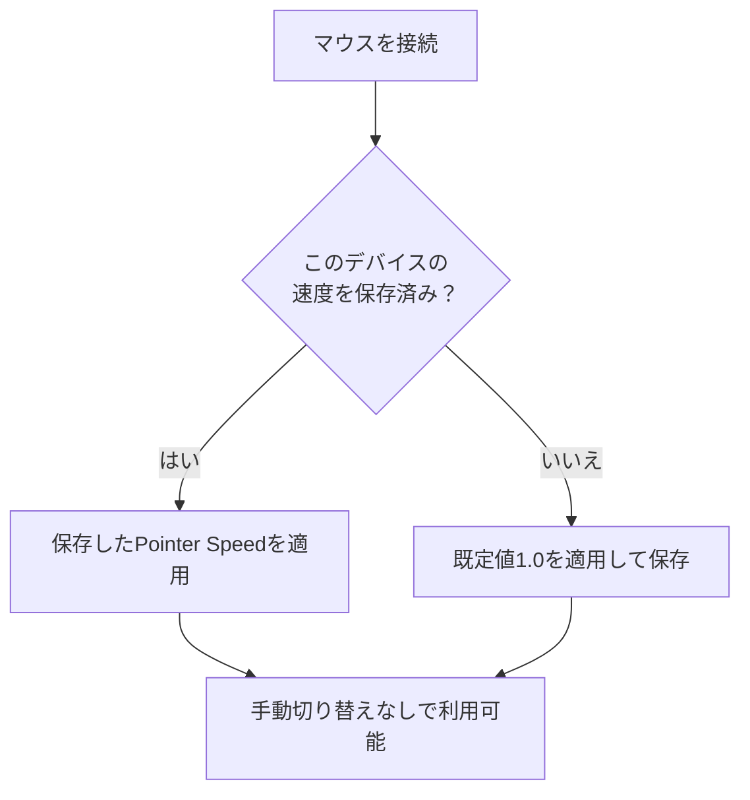

import ThemedImage from '@theme/ThemedImage';
import useBaseUrl from '@docusaurus/useBaseUrl';

# ポインタ速度と応答の調整 {#pointer-speed--acceleration}

macOS標準の設定より細かくマウスの操作感を調整したい場合は、Mouse+の**Feel Adjustment**を使います。

## Pointer Speed {#pointer-speed}

Feel Adjustmentには**Pointer Speed**という1つのスライダーがあります。範囲は0.1–5.0、既定値は1.0です。macOSのポインタ応答を調整し、変更はすぐに反映されます。アプリを再起動せず、ポインタを動かしながら感触を確かめられます。値を下げると動きが遅くなり、細かな操作をしやすくなります。[Macでマウス加速度を調整する](/ja/docs/mouse-plus/recipes/disable-mouse-acceleration-mac)もご覧ください。

Pointer SpeedはmacOSの`HIDMouseAcceleration`を通じて動作し、ハードウェアDPIとは異なります。Feel AdjustmentにDPIスライダーはありません。対応Logitechマウスでは、別のHID++機能でハードウェアDPIを調整でき、USBとBluetoothの両方に対応します。

## デバイス別の保存 {#per-device-persistence}

**Pointer Speed**はマウスごとに保存されます。デスク用と持ち運び用で異なる値を設定でき、接続時に対応する値が自動適用されます。ただし、同じ機種のマウスを複数使う場合、同じVID:PIDの個体は区別できず、設定を共有します。

<ThemedImage
  alt={"LinguaXのポインタ関連設定。Feel AdjustmentのPointer Speedは、対応Logitech機種のハードウェアDPIとは別の設定です"}
  sources={{
    light: useBaseUrl('/img/linguax-pointerspeed-dpi-reverse-scroll.png'),
    dark: useBaseUrl('/img/linguax-pointerspeed-dpi-reverse-scroll-dark.png'),
  }}
  width="420"
/>

## 関連ドキュメント {#related-docs}

- [スムーズスクロール](/ja/docs/mouse-plus/fundamentals/smooth-scrolling)
- [デバイスの互換性](/ja/docs/mouse-plus/device-compatibility)
