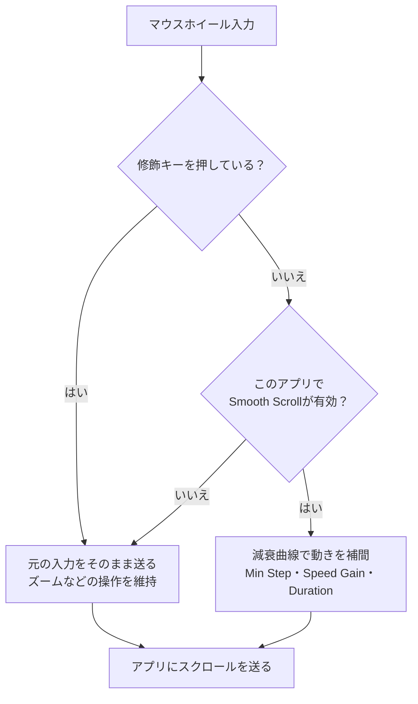

import ThemedImage from '@theme/ThemedImage';
import useBaseUrl from '@docusaurus/useBaseUrl';

# スムーズスクロール {#smooth-scrolling}

マウスホイールのスクロールは、macOSでは段階的に飛ぶように感じることがあります。Mouse+はホイール入力を滑らかな動きに変換し、長いページやコードを読みやすくします。

## 仕組み {#how-it-works}

Mouse+は、マウスからのスクロール入力をアプリに届く前に処理します。ホイールの1段ずつの入力を、減衰する曲線に沿った動きへ補間します。平滑化を無効にした場合や一時的に通過させる場合は、元のスクロール距離を保ちます。

<ThemedImage
  alt={"LinguaXのSmooth Scroll設定。Min Step、Speed Gain、Durationのスライダーと、⌘⌥⌃⇧またはFnを押すと一時停止する案内"}
  sources={{
    light: useBaseUrl('/img/linguax-smooth-scroll.png'),
    dark: useBaseUrl('/img/linguax-smooth-scroll-dark.png'),
  }}
  width="420"
/>

## 設定 {#settings}

操作感は3つの全体共通スライダーで調整します。

- **Min Step** — 1イベントに適用する最小のスクロール量。範囲1.0–100.0、既定値33.6。下げると細かく、上げると大きく移動します。
- **Speed Gain** — スクロールの移動量を拡大する倍率。範囲1.0–10.0、既定値2.70。上げると速く移動し、下げると細かく操作できます。
- **Duration** — 慣性が続く長さ。範囲1.0–5.0、既定値4.35。上げると余韻が長く、下げると早く止まります。

この3つは全体共通で、すべてのアプリに同じ値が適用されます。

平滑化するのはマウスホイールだけです。トラックパッドの連続スクロールは、そのまま通過させます。修飾キー（`⌘`、`⌥`、`⌃`、`⇧`、`fn`のいずれか）を押している間は平滑化を一時停止し、ズームなどの修飾キー付きスクロールを保ちます。

調整は1項目ずつ行い、よく使うアプリで数分試してから次を変更しましょう。読書やコード編集では、Speed GainとDurationを中程度から試すと調整しやすくなります。

## アプリ別の上書き設定 {#per-app-overrides}

ブラウザとコードエディタで使い分けたい場合は、**Smooth Scrollのオン・オフだけ**をアプリ別に設定できます。Min Step、Speed Gain、Durationと反転方向は全体共通です。[アプリ別の上書き設定](/ja/docs/mouse-plus/fundamentals/app-scoped-overrides)をご覧ください。

## スクロール方向の反転 {#reverse-scroll-direction}

トラックパッドとは独立して、マウスのスクロール方向を反転できます。全体共通の**Reverse Vertical Scroll**（縦）と**Reverse Horizontal Scroll**（横）を、それぞれ設定します。[マウスだけスクロール方向を反転する](/ja/docs/mouse-plus/recipes/reverse-scroll-direction-mouse-only-mac)をご覧ください。

## 関連ドキュメント {#related-docs}

- [macOSのマウススクロールのカクつきを改善する](/ja/docs/mouse-plus/recipes/fix-choppy-mouse-scrolling-macos)
- [アプリ別の上書き設定](/ja/docs/mouse-plus/fundamentals/app-scoped-overrides)
