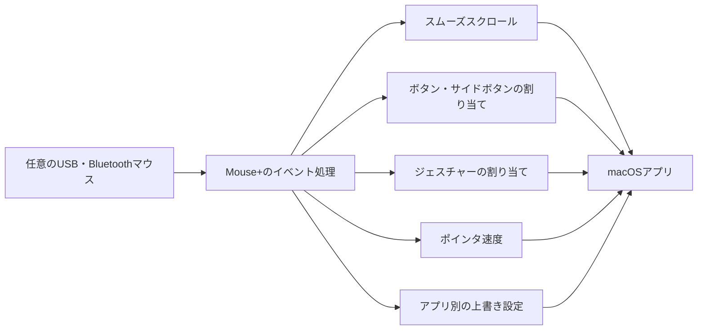

import ThemedImage from '@theme/ThemedImage';
import useBaseUrl from '@docusaurus/useBaseUrl';

# Mouse+：macOSのマウスを使いやすく {#mouse--mouse-enhancement-for-macos}

Mouse+は、macOSで使うマウスの操作感を整えます。スクロールを滑らかにし、サイドボタンやジェスチャーに操作を割り当て、アプリごとに動作を変えられます。軽量な1つのアプリで使え、ドライバは不要です。

約10 MBのネイティブmacOSアプリで、Electronやアカウントは不要。行動データの収集やカーネル拡張のインストールもありません。基本機能は任意のUSB・Bluetoothマウスで使え、機種固有のボタンなどの拡張対応は22機種です。

<ThemedImage
  alt={"LinguaX Mouse+のMX Master 3S設定画面。上部で対象アプリを切り替え、マウス図のボタンをクリックして設定できます"}
  sources={{
    light: useBaseUrl('/img/linguax-mouse-gesture-mapping.png'),
    dark: useBaseUrl('/img/linguax-mouse-gesture-mapping-dark.png'),
  }}
  width="420"
/>

## Mouse+でできること {#what-mouse-does}

- **[スムーズスクロール](/ja/docs/mouse-plus/fundamentals/smooth-scrolling)** — ホイールの段階的な動きを、調整可能な滑らかなスクロールにします。
- **[ボタン・サイドボタンの割り当て](/ja/docs/mouse-plus/fundamentals/button-mapping)** — サイドボタン、ホイールチルト、親指ボタンに、アプリ起動、システム操作、メディア操作、ショートカットを割り当てます。
- **[ジェスチャーの割り当て](/ja/docs/mouse-plus/fundamentals/gesture-mapping)** — クリック、ダブルクリック、長押し、方向別ドラッグに操作を割り当てます。
- **[ポインタ速度](/ja/docs/mouse-plus/fundamentals/pointer-speed)** — **Feel Adjustment → Pointer Speed**でマウスの応答を細かく調整し、すぐに反映します。
- **[アプリ別の上書き設定](/ja/docs/mouse-plus/fundamentals/app-scoped-overrides)** — Xcode、Figma、ブラウザなどに、Smooth Scrollのオン・オフとジェスチャーを個別設定します。
- **[デバイスの互換性](/ja/docs/mouse-plus/device-compatibility)** — 基本機能は任意のUSB・Bluetoothマウスで利用可能。MX Master、G502、M720など、主にLogitechの22機種に拡張認識があります。

## ネイティブで軽量な理由 {#why-native--lightweight}

- **約10 MBのネイティブアプリ。** Electronやブラウザエンジンを同梱しません。
- **アカウント不要、行動データの収集なし。** 主要なマウス機能と入力ソース切り替えはローカルで動作します。AIxはAI操作を実行して転送に同意した場合のみテキストを送信します。ダウンロード、更新、ライセンス検証には通信を使います。
- **スリープ復帰に対応。** Bluetoothデバイスを自動復旧し、Macの復帰時に主要サービスを更新します。
- **ドライバ不要。** システムレベルに拡張をインストールせず、アプリを削除すればアンインストールできます。

## 関連ドキュメント {#related-docs}

- [初回設定](/ja/docs/getting-started/first-run)
- [macOSでサイドボタンを割り当てる](/ja/docs/mouse-plus/recipes/map-mouse-side-buttons-macos)
- [macOS向けLogi Options+の代替](/ja/docs/comparisons/logi-options-plus-alternative-macos)
- [Mac向けBetterMouseの代替](/ja/docs/comparisons/bettermouse-alternative-mac)
- [Mos・LinearMouse・Mac Mouse Fixの比較](/ja/docs/comparisons/mos-vs-linearmouse-vs-mac-mouse-fix)
