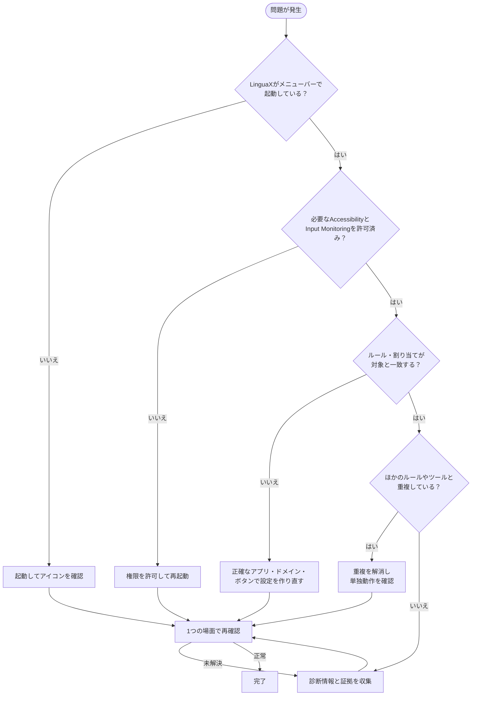

よくある問題と、順番に試せる復旧手順をまとめています。

## マウスに関する問題 {#mouse-related-problems}

スクロール、サイドボタン、ジェスチャー、ポインタ速度、デバイス認識は、専用ページで説明しています。

- [マウスの問題](/ja/docs/troubleshooting/mouse-issues)

**LinguaXを入れた直後からボタンが動かない場合**は、Logi Options+やMac Mouse Fixなどが先にイベントを取得している可能性があります。[macOSでマウスツールの競合を解消する](/ja/docs/troubleshooting/conflicts-with-other-tools#mouse-utility-conflict)をご覧ください。多くの場合、もう一方のツールの入力監視権限をオフにすると解消します。

以下では、入力ソース切り替えと自動化の問題を扱います。

## 1）入力ソースが切り替わらない {#1-input-source-does-not-switch}

確認すること：

- LinguaXが起動し、メニューバーに表示されている。
- ルールが有効になっている。
- アプリやドメインの指定が対象と一致している。

対処：

1. 問題が起きる対象のルールを1つだけにします。
2. 重複するルールを整理します。
3. 別のアプリやサイトへ移動してから戻り、再確認します。

## 2）ブラウザのドメインルールが反応しない {#2-browser-domain-rule-does-not-trigger}

確認すること：

- 対応ブラウザを使っている。Safari、Chrome、Edge、Brave、Operaに対応し、Firefoxには対応していません。
- ドメインを正しく入力している。
- ルールが有効になっている。
- **Accessibility**が許可されている。

対処：

1. 正確なドメインでルールを作り直します。
2. ブラウザのアプリルールをシンプルにします。
3. 明確に異なる2つのドメインで試します。

## 3）ショートカットのスクリプトが失敗する {#3-shortcut-script-action-fails}

確認すること：

- ほかのアプリがショートカットを取得していない。
- スクリプトアクションが正しく割り当てられている。

対処：

1. まず組み込みテンプレートを1つ実行します。
2. macOSのオートメーション許可が表示されたら承認します。
3. カスタムのAppleScriptを再実行します。

## 4）更新後に動作が変わった {#4-behavior-changed-after-update}

確認すること：

- LinguaXを再起動する。
- リリースノートで移行に関する説明を確認する。

対処：

1. 初回起動時のデータ移行が終わるまで待ちます。
2. 最小限のルールで試します。
3. ルールを少しずつ戻します。

## 5）権限に関する問題 {#5-permission-related-problems}

対処：

1. macOSの設定で、不足している権限を許可し直します。
2. LinguaXを再起動します。
3. アプリルールとドメインルールを1つずつ試します。アプリ単位の入力切り替え自体にはAccessibilityは不要です。

## 推奨する切り分け順 {#recommended-debug-order}

1. アプリの起動状態。
2. 権限。
3. アプリ・ドメインの一致。
4. 重複ルールの整理。
5. 最小構成での再確認。

## 解決しない場合 {#still-not-resolved}

- [macOSの権限](/ja/docs/troubleshooting/permissions-on-macos)
- [アプリとWebサイトのルール](/ja/docs/input-source/app-and-website-rules)
- [ログと診断](/ja/docs/troubleshooting/logs-and-diagnostics)
