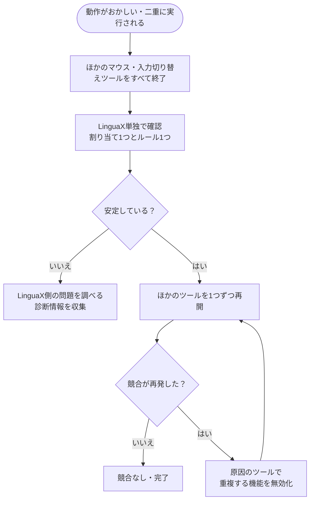

LinguaXとほかのマウス・入力自動化ツールを同時に使うと、動作が競合することがあります。同じマウスやキーボードのイベントを複数のツールが処理するため、機能ごとに担当するツールを1つに絞ります。

## マウスツールの競合 {#mouse-tool-conflicts}

**Logi Options+**、**Mos**、**LinearMouse**、**BetterMouse**、**Mac Mouse Fix**も、スクロールやボタン、ポインタのイベントを処理します。同時に使うと、次の問題が起こることがあります。

- スクロールが二重に平滑化される、カクつく、方向が逆になる
- サイドボタンやジェスチャーが2回実行される、一方がもう一方を上書きする
- ポインタ速度がツール同士で競合する
- 別のツールが先にイベントを取得し、特定のアプリでだけボタンが動かない

### 単独動作の確認：マウス {#isolation-test-mouse}

1. ほかのマウスツールを終了します。メニューバー常駐やログイン項目も確認します。
2. LinguaXだけを起動します。
3. スムーズスクロール、サイドボタン1つ、ジェスチャー1つを試します。

安定した場合は、ツール間の競合が考えられます。

### 対処：マウス {#mitigation-mouse}

- スムーズスクロール、ボタン・ジェスチャー、ポインタ速度の各機能を、それぞれ1つのツールだけで設定します。
- ほかの機能を使い続けたい場合は、競合する機能を無効にします。
- 同じボタンを2つのツールで同時に割り当てないようにします。

### macOSでマウスツールの競合を解消する（Options+・Mac Mouse Fixなど） {#mouse-utility-conflict}

同じイベントを複数のツールが取得している場合は、次のいずれかで処理元を絞れます。

#### 方法A：もう一方の入力監視を解除する（元に戻せます） {#option-a--revoke-input-monitoring-from-the-other-tool-reversible}

すぐに試せて、必要ならオンに戻せる方法です。

1. **システム設定 → プライバシーとセキュリティ → 入力監視（Input Monitoring）**を開きます。**アクセシビリティ（Accessibility）**も同様に確認します。

   

2. 競合するツールをオフにし、LinguaXはオンのままにします。

   

3. **確認：** LinguaX → **Diagnostics Center → Realtime Events**でサイドボタンを押し、イベントが表示されることを確認します。

**注意点：** Options+などがデバイスに書き込んだSmartShift、DPI、バックライトの設定は、入力監視を解除しても残ります。これらはシステムの権限とは別です。LinguaXには[Pointer Speed](/ja/docs/mouse-plus/fundamentals/pointer-speed)があり、対応Logitechマウスでは別途HID++経由のハードウェアDPI調整も使えます。[Logi Options+なしでMX Master 3Sを設定する](/ja/docs/comparisons/mx-master-3s-mac-setup-without-logi-options)もご覧ください。

#### 方法B：もう一方のツールをアンインストールする {#option-b--uninstall-the-other-tool-clean-slate}

ほかの機能も不要であれば、アンインストールすると競合の原因を減らせます。

- **Logi Options+：** アプリ内のアンインストーラを使い、残っている場合は`~/Library/LaunchAgents/com.logi.optionsplus.*`も確認します。詳しくは[移行ガイド](/ja/docs/comparisons/mx-master-3s-mac-setup-without-logi-options#2-quit-and-uninstall-options)をご覧ください。
- **Mac Mouse Fix：** アプリのメニューから*Uninstall*を実行します。
- **そのほか：** 提供元のアンインストール手順に従います。

方法Aと同じ手順でDiagnostics Centerのイベントを確認します。

#### どちらを選べばよいですか？ {#which-one-should-i-use}

- **権限の解除** — Options+ FlowやKVMのキーボード共有など、もう一方の特定機能を使い続けたい場合。
- **アンインストール** — 使っていた機能をLinguaXでまかなえ、常に単独で使いたい場合。

## 入力ソース切り替えツールの競合 {#input-method-tool-conflicts}

複数の入力自動化ツールを使うと、次の問題が起こることがあります。

- 入力ソースが意図せず切り替わる
- ルールの反応が遅れたり、安定しなかったりする
- アプリごとに理由の分からない動作の違いが出る

### 単独動作の確認：入力ソース {#isolation-test-input}

1. ほかの入力ソース切り替え・自動化ツールを終了します。
2. LinguaXだけを起動します。
3. アプリルールとブラウザのドメインルールを1つずつ試します。

安定した場合は、入力ツール間の競合が考えられます。

### 対処：入力ソース {#mitigation-input}

- 入力ソースの切り替えを担当するツールを1つにします。
- ほかのツールの重複する自動化を無効にします。
- 同じルールを複数のツールに作らないようにします。

## 復旧の手順 {#recovery-sequence}

マウスと入力ソースのどちらも、次の順序で確認できます。

1. LinguaXの設定を最小限にします。割り当て1つ、またはアプリ・ドメインルール1つに絞ります。
2. LinguaX単独で安定することを確認します。
3. ほかのツールを1つずつ起動します。
4. 競合が再発したら、そのツールの重複する機能を無効にします。

## 関連ドキュメント {#related-docs}

- [マウスの問題](/ja/docs/troubleshooting/mouse-issues)
- [よくある問題](/ja/docs/troubleshooting/common-issues)
- [macOSの権限](/ja/docs/troubleshooting/permissions-on-macos)
- [ログと診断](/ja/docs/troubleshooting/logs-and-diagnostics)
