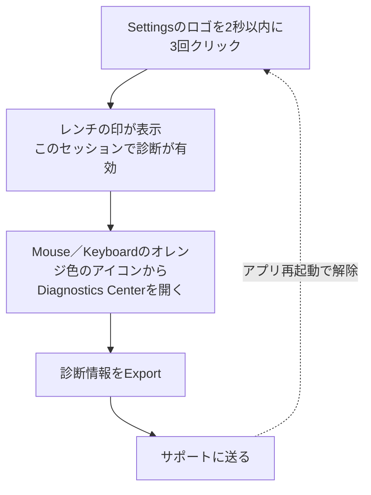

import ThemedImage from '@theme/ThemedImage';
import useBaseUrl from '@docusaurus/useBaseUrl';

診断情報と再現手順をそろえると、問題の調査を進めやすくなります。

## リリース版で診断を有効にする {#how-to-enable-diagnostics-in-release-build}

### Settingsから現在のセッションで有効にする {#session-unlock-from-settings}

1. LinguaXの**Settings**を開きます。
2. アプリのロゴを**2秒以内に3回以上**クリックします。
3. ロゴにレンチの印が表示されたら、現在のセッションで診断が有効になっています。
4. **Mouse**または**Keyboard**を開き、オレンジ色の指のアイコン（**Diagnostics Center**）をクリックします。診断情報をエクスポートしてサポートに送れます。

補足：

- この有効化は**一時的**で、アプリを再起動すると解除されます。
- ターミナルのコマンドは不要です。
- 以前のターミナルによる切り替え方法は非推奨で、新しいmacOSでは安定して動かない場合があります。

<ThemedImage
  alt={"更新を実行する前のDiagnostics Center"}
  sources={{
    light: useBaseUrl('/img/linguax-diagnostics-before.png'),
    dark: useBaseUrl('/img/linguax-diagnostics-before-dark.png'),
  }}
  width="256"
/>
<ThemedImage
  alt={"更新を実行した後のDiagnostics Center"}
  sources={{
    light: useBaseUrl('/img/linguax-diagnostics-after.png'),
    dark: useBaseUrl('/img/linguax-diagnostics-after-dark.png'),
  }}
  width="256"
/>

## 集める情報 {#what-to-collect}

- LinguaXのバージョン
- macOSのバージョン
- 問題が起きたアプリ・ブラウザ名
- 対象のドメイン（Webサイトのルールに関する場合）
- 問題が起きた時刻
- 期待した動作と実際の動作
- 簡潔な再現手順

## 再現手順のテンプレート {#reproduction-template}

1. `<アプリまたはWebサイト>`を開く。
2. `<状態A>`から`<状態B>`へ切り替える。
3. 実際の動作：`<起きたこと>`。
4. 期待した動作：`<本来起きるはずのこと>`。

## ルールの記録 {#rule-snapshot-checklist}

問い合わせる前に、次の設定を記録します。

- 適用されるはずのアプリルール
- 適用されるはずのドメインルール（ある場合）
- 対象が広いルールや、重複するルール

## 添付すると役立つもの {#evidence-to-attach}

- 関係するルール設定のスクリーンショット
- 短い画面録画
- アプリ内に表示されたエラーメッセージの正確な文面

個人情報などの機密データが含まれないようにしてください。

## 問い合わせ前の最小確認 {#minimal-validation-before-contacting-support}

1. LinguaXを再起動します。
2. 単純化したルールを1つ試します。
3. 元の手順で再確認します。

解決しない場合は、集めた診断情報を添えてお問い合わせください。

## フィードバックの特典 {#feedback-reward-policy}

フィードバックが採用され、リリースに反映された場合は、1年間のライセンスを進呈します。

## 関連ドキュメント {#related-docs}

- [マウスの問題](/ja/docs/troubleshooting/mouse-issues)
- [よくある問題](/ja/docs/troubleshooting/common-issues)
- [macOSの権限](/ja/docs/troubleshooting/permissions-on-macos)
- [ほかのツールとの競合](/ja/docs/troubleshooting/conflicts-with-other-tools)
