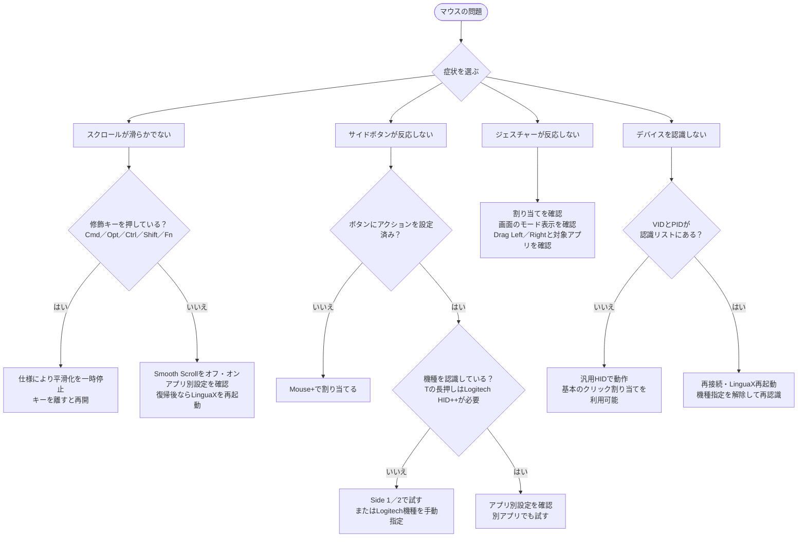

# マウスの問題 {#mouse-issues}

Mouse+で起こりやすい問題を症状別にまとめています。**症状 → 確認 → 対処**の順に進めてください。

権限が原因と思われる場合は[macOSの権限](/ja/docs/troubleshooting/permissions-on-macos)を、ほかのマウスツールも動いている場合は[ほかのツールとの競合](/ja/docs/troubleshooting/conflicts-with-other-tools)を先に確認します。

## スクロールが滑らかでない・途中で止まる {#scrolling-is-not-smooth-or-stops-working}

症状：スクロールが段階的に動く、しばらく使うと平滑化されなくなる、スリープ後に動かなくなる。

確認：

- 全体でSmooth Scrollが有効で、対象アプリの**Smooth Scroll**も有効になっている。
- 対象アプリの上書き設定でオフになっていない。
- **Accessibility**と**Input Monitoring**が許可されている。スムーズスクロールにはマウスイベントの取得が必要です。
- マウスホイールで試している。トラックパッドの入力は意図的に変更しません。

対処：

1. **Smooth Scroll**を一度オフにしてからオンにします。
2. 対象アプリの**Smooth Scroll**がオフになっていないか確認します。Min Step、Speed Gain、Durationと反転方向は全体共通で、アプリ別に変えられるのはオン・オフだけです。
3. スリープ復帰後から動かない場合は、LinguaXを再起動し、イベント取得とHIDサービスを初期化します。
4. Finderやテキストエディットなどで基本動作を試します。
5. `⌘⌥⌃⇧`やFnを押している間だけ止まるのは仕様です。キーを離すと再開します。

## サイドボタンが反応しない {#side-buttons-do-not-respond}

症状：サイドボタンや親指ボタンを押しても反応しない、特定のアプリでしか動かない。

確認：

- 対象ボタンにアクションが割り当てられている。
- 必要な機種固有スロットを認識している。リスト外の機種でも基本のクリック割り当ては使えます。
- 現在のアプリのジェスチャー上書きが、割り当てを変更・解除していない。

対処：

1. ボタン設定でアクションの割り当てを確認します。
2. 対象アプリにジェスチャーの上書き設定があれば、調整するか解除します。
3. 親指ボタン（`T`）の長押しはLogitech HID++経由でのみ利用できます。対応するLogitech機種として認識されているか確認します。
4. 別のアプリでも同じボタンを試し、全体の問題かアプリ別の問題か切り分けます。

## ジェスチャーが反応しない {#gestures-do-not-trigger}

症状：スワイプ、長押し、Modifier Holdが反応しない、または安定しない。

確認：

- 対象ボタンにジェスチャーが割り当てられている。
- 長押しは0.5秒以上、スワイプは明確な方向へのドラッグで行っている。
- **Drag Left / Drag Right**などの方向と、現在のアプリの上書き設定が意図した内容になっている。

対処：

1. ボタンのジェスチャー割り当てを設定し直すか、内容を再確認します。
2. スワイプははっきりした方向に動かし、画面のモード表示を確認します。
3. **Modifier Hold**は、押している間だけ**Fn（Globe）**を保持し、離すと解除します。選べる修飾キーはFnのみです。
4. 左右のドラッグ操作が想定と異なる場合は、**Drag Left / Drag Right**の割り当てと対象アプリを確認します。

## Pointer Speedが合わない・元に戻る {#pointer-speed-is-wrong-or-resets}

症状：ポインタが速すぎる・遅すぎる、マウスを切り替えると速度が変わる。

確認：

- **Pointer Speed**はデバイス別に保存される。
- 調整したいマウスが現在の対象デバイスになっている。

対処：

1. 対象マウスを選んで速度を調整します。再起動せずに反映されます。
2. 複数のマウスを使う場合は、それぞれの値を確認します。同じ機種で同じVID:PIDの個体は設定を共有します。
3. 反映されない場合はLinguaXを再起動します。

## デバイスを認識しない {#device-not-recognized}

症状：マウスが検出されない、対応機種なのに自動のボタン割り当てが表示されない。

確認：

- Bluetooth、レシーバー、有線のいずれかで接続されている。
- LogitechのBLE HID++を使う場合、ペアリング済みでスリープしていない。
- 以前の**Clear model binding**で機種指定が解除されていない。

対処：

1. デバイス一覧を確認し、Bluetoothマウスは接続状態やバッテリーも確認します。
2. マウスを起こし、一覧が自動更新されるまで待ちます。
3. 誤った機種のままなら、デバイス設定の**Clear model binding**で解除して再接続します。
4. [デバイスの互換性](/ja/docs/mouse-plus/device-compatibility)で対応状況を確認します。Magic Mouse 2は設定可能なボタンがなく、一覧には表示されません。

## スリープ復帰後に割り当てが動かない {#mappings-fail-after-sleepwake}

症状：Macの復帰後、ボタン・ジェスチャー・スムーズスクロールが動かない。

確認：

- Bluetoothの再接続に少し時間がかかる場合がある。
- 長時間の利用でイベント取得がタイムアウトする場合がある。

対処：

1. 復帰後、Bluetoothデバイスの自動復旧を数秒待ちます。
2. 戻らない場合はLinguaXを再起動し、主要サービスを再初期化します。
3. **Accessibility**と**Input Monitoring**が引き続き許可されているか確認します。

## 解決しない場合 {#still-not-resolved}

問題が続く場合は、診断情報を集めてサポートへお問い合わせください。

## 関連ドキュメント {#related-docs}

- [macOSの権限](/ja/docs/troubleshooting/permissions-on-macos)
- [ほかのツールとの競合](/ja/docs/troubleshooting/conflicts-with-other-tools)
- [ログと診断](/ja/docs/troubleshooting/logs-and-diagnostics)
- [Mouse+の概要](/ja/docs/mouse-plus/overview)
