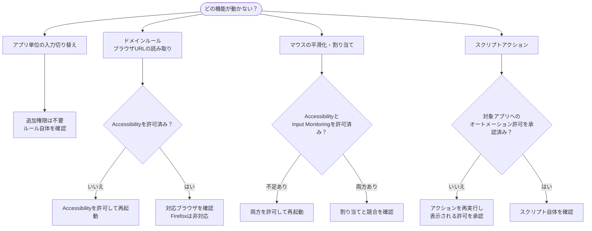

LinguaXでは、マウス操作やWebサイトの検出にmacOSの権限を使います。

## よくある症状 {#common-symptoms}

- アプリを切り替えても入力ソースが変わらない
- ブラウザのドメインルールが安定しない
- 初回実行時にスクリプトアクションが失敗する

LinguaXの主要な権限設定は、次の2つです。

## 必要な権限 {#required-permissions}

- **Accessibility（アクセシビリティ）** — マウスイベントの取得、スムーズスクロール、ポインタ速度、キー操作の送信、Webサイトのルール用に前面タブのURLを読み取る処理。
- **Input Monitoring（入力監視）** — HIDデバイスの管理。

> アプリ単位の入力ソース切り替えにはAccessibilityは不要です。**Webサイト（ドメイン）のルール**でブラウザのURLを読み取る場合は必要です。

## 確認すること {#required-checks}

1. LinguaXの権限状態を開きます。
2. macOSの**システム設定**で、必要な権限が有効か確認します。
3. 権限を変更したらLinguaXを再起動します。

## スクリプト実行時の許可 {#about-script-action-prompts}

AppleScriptがSystem EventsやFinderなどのアプリを操作する場合、macOSが別途オートメーションの許可を求めることがあります。

該当する操作を使うには、表示された許可を承認します。

## 復旧の手順 {#recovery-flow}

1. LinguaXを終了します。
2. LinguaXを開き直します。
3. 不足している権限を許可し直します。
4. アプリルールを1つ試します。
5. ドメインルールを1つ試します。
6. スクリプトを使う場合は、テンプレートを1つ再実行します。

## 更新後について {#post-update-note}

ストレージ構成を更新したバージョンでは、初回起動時のデータ移行に時間がかかる場合があります。移行が終わってから動作を確認してください。

## 関連ドキュメント {#related-docs}

- [初回設定](/ja/docs/getting-started/first-run)
- [マウスの問題](/ja/docs/troubleshooting/mouse-issues)
- [よくある問題](/ja/docs/troubleshooting/common-issues)
- [ショートカットとホットキー](/ja/docs/concepts/shortcut-and-hotkeys)
