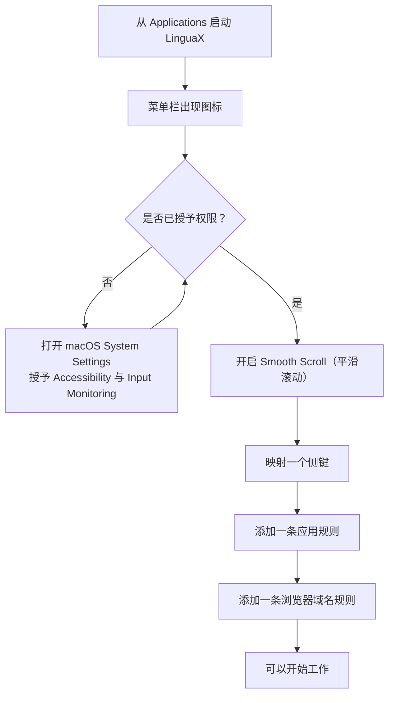

import ThemedImage from '@theme/ThemedImage';
import useBaseUrl from '@docusaurus/useBaseUrl';

安装完成后，按照本指南花几分钟完成基础配置，即可开始使用 LinguaX。

## 首次运行流程一览 {#the-first-run-flow-at-a-glance}

下面五个步骤会逐一介绍这些设置。

## 第 1 步：启动 {#step-1-launch}

1. 从 **Applications**（应用程序）打开 LinguaX。
2. 确认菜单栏中显示应用图标。

<ThemedImage
  alt={"macOS 菜单栏示意图：LinguaX 鼠标图标位于电池、Wi-Fi、控制中心和时钟附近"}
  sources={{
    light: useBaseUrl('/img/linguax-menubar-icon.svg'),
    dark: useBaseUrl('/img/linguax-menubar-icon-dark.svg'),
  }}
  width="720"
/>

## 第 2 步：授予权限 {#step-2-grant-permissions}

1. 打开 LinguaX **Settings**（设置），勾选 **Permission: Accessibility**（辅助功能权限）和 **Permission: Input Monitoring**（输入监控权限）。
2. macOS 会自动打开对应的 System Settings（系统设置）页面，在其中开启 LinguaX。
3. 返回 LinguaX，确认两项权限均保持勾选。

Accessibility 用于鼠标事件、平滑滚动、指针速度以及读取浏览器 URL；Input Monitoring 用于 HID 设备管理。仅按应用切换输入法无需 Accessibility，按网站域名切换则需要。

<ThemedImage
  alt={"LinguaX Settings 中已勾选 Permission: Accessibility 和 Permission: Input Monitoring；勾选后会打开对应的 macOS 系统设置页面"}
  sources={{
    light: useBaseUrl('/img/linguax-mouse-permission.png'),
    dark: useBaseUrl('/img/linguax-mouse-permission-dark.png'),
  }}
  width="420"
/>

## 第 3 步：先完成一项 Mouse+ 设置 {#step-3-start-with-one-mouse-win}

1. 开启 **Smooth Scroll**（平滑滚动）。
2. 设置一个你会经常使用的鼠标动作。
3. 在主要使用的应用中，确认指针与滚动表现稳定。

<ThemedImage
  alt={"LinguaX Mouse+ 页面中的当前设备与可点击按键图"}
  sources={{
    light: useBaseUrl('/img/linguax-mouse-gesture-mapping.png'),
    dark: useBaseUrl('/img/linguax-mouse-gesture-mapping-dark.png'),
  }}
  width="420"
/>

## 第 4 步：验证 {#step-4-verify}

1. 为主要使用的编辑器添加一条应用规则。
2. 添加一条浏览器域名规则。
3. 在这些场景之间切换，确认输入法符合预期。

<ThemedImage
  alt={"LinguaX 输入法规则面板中的应用规则"}
  sources={{
    light: useBaseUrl('/img/linguax-input-method-app-mapping.png'),
    dark: useBaseUrl('/img/linguax-input-method-app-mapping-dark.png'),
  }}
  width="420"
/>

## 第 5 步：可选功能检查 {#step-5-optional-feature-checks}

- 如有需要，再添加一条鼠标映射。
- 如果使用脚本动作，运行一个内置模板，并在 macOS 显示 Automation（自动化）提示时批准对应操作。

## 接下来阅读 {#next-reading}

- [快速导览](/zh-Hans/docs/getting-started/quick-tour)
- [Mouse+ 概览](/zh-Hans/docs/mouse-plus/overview)
- [应用与网站规则](/zh-Hans/docs/input-source/app-and-website-rules)
- [常见问题排查](/zh-Hans/docs/troubleshooting/common-issues)
