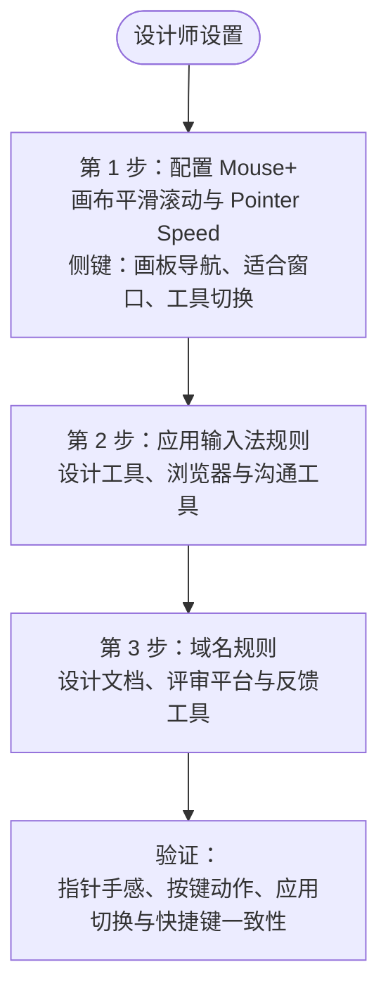

本指南面向需要稳定指针表现和快捷操作的创意工作流。先配置 Mouse+：长时间使用设计工具时，精确的滚动和指针控制最能改善体验。输入法规则可在鼠标手感合适后独立配置。

## 第 1 步：配置 Mouse+ {#step-1-mouse-focus}

从影响最大的鼠标设置开始。

1. 开启 **Smooth Scroll**（平滑滚动），用于画布、图层列表和长画板。
2. 在 **Feel Adjustment**（手感调整）中调整 **Pointer Speed**（指针速度），并在设计工具中测试手感。该滑块调整 macOS 的指针响应，不是硬件 DPI 设置，也不保证 1:1 追踪。
3. 将鼠标按键映射到常用设计操作，例如：
   - 在画板或界面之间前进、后退。
   - 缩放至适合窗口，或切换常用工具。
   - 切换 Space，在设计应用与参考资料之间移动。

如果鼠标具有可倾斜滚轮，也可以映射滚轮倾斜槽位（`WL`/`WR`）。

## 第 2 步：应用输入法规则 {#step-2-app-input-source-rules}

指针手感合适后，为以下应用添加规则：

- 主要设计工具。
- 浏览器。
- 沟通或评审工具。

先保持默认设置简单，再逐步细化。

## 第 3 步：优先添加的域名规则 {#step-3-domain-rules-to-add-first}

- 设计文档网站。
- 内部评审工具。
- 反馈平台。

## 验证清单 {#validation-checklist}

1. 确认设计应用中的指针和滚动表现稳定。
2. 触发已映射的鼠标按键，确认动作执行。
3. 在设计应用和浏览器之间切换。
4. 确认两者的输入法符合预期，快捷操作保持一致。

## 相关文档 {#related-docs}

- [Mouse+ 概览](/zh-Hans/docs/mouse-plus/overview)
- [指针速度](/zh-Hans/docs/mouse-plus/fundamentals/pointer-speed)
- [应用与网站规则](/zh-Hans/docs/input-source/app-and-website-rules)
- [常见问题排查](/zh-Hans/docs/troubleshooting/common-issues)
