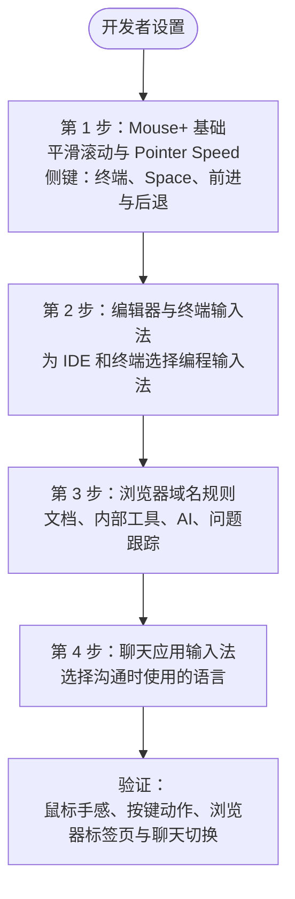

本指南面向经常在编辑器、终端、浏览器和聊天工具之间切换的开发者。先配置 Mouse+：日常工作中导航和滚动占用大量时间，稳定的指针表现和几个常用按键映射能立即改善操作体验。之后再配置独立的输入法自动切换模块。

## 第 1 步：Mouse+ 基础 {#step-1-mouse-foundation}

先完成鼠标配置。

1. 开启 **Smooth Scroll**（平滑滚动），让代码和长文档的滚动更连贯。
2. 在 **Feel Adjustment**（手感调整）中设置舒适的 **Pointer Speed**（指针速度）。此滑块调整 macOS 的指针响应，不代表硬件 DPI，也不保证 1:1 追踪。
3. 将侧键映射到最常重复的开发操作，例如：
   - 打开或聚焦终端。
   - **Switch Space Left/Right**（切换到左侧或右侧桌面）。
   - 在浏览器或编辑器历史中前进、后退。

如果鼠标具有可倾斜滚轮，也可以映射滚轮倾斜槽位（`WL`/`WR`），例如用于切换 Space。

## 第 2 步：编辑器与终端输入法 {#step-2-editor--terminal-input-source}

鼠标手感调整好后，为常用应用添加输入法规则。

1. 编辑器或 IDE → 编程输入法（通常是纯 ASCII 输入源）。
2. 终端 → 编程输入法。

这样，应用获得焦点时，输入法就会自动切换到预期状态。

## 第 3 步：浏览器域名规则 {#step-3-browser-domain-rules}

按域名为文档和工具细化浏览器的输入法设置。

从每天反复访问的域名开始：

- 文档网站。
- 内部工具。
- AI 助手。
- 问题跟踪或评审系统。

## 第 4 步：聊天应用输入法 {#step-4-chat-app-input-source}

为聊天应用选择日常沟通语言对应的输入法。

## 验证流程 {#validation-loop}

1. 确认鼠标在 IDE、终端和浏览器中表现稳定。
2. 触发已映射的侧键，确认动作执行。
3. 在两个已配置的浏览器域名之间切换。
4. 在浏览器和聊天应用之间切换，确认输入法正确。

## 日常维护建议 {#maintenance-guidance}

- 避免重复、重叠的规则。
- 使用明确的域名规则。
- 定期清理不再使用的规则。

## 相关文档 {#related-docs}

- [Mouse+ 概览](/zh-Hans/docs/mouse-plus/overview)
- [应用与网站规则](/zh-Hans/docs/input-source/app-and-website-rules)
- [多语言工作流](/zh-Hans/docs/input-source/multilingual-workflow)
- [常见问题排查](/zh-Hans/docs/troubleshooting/common-issues)
