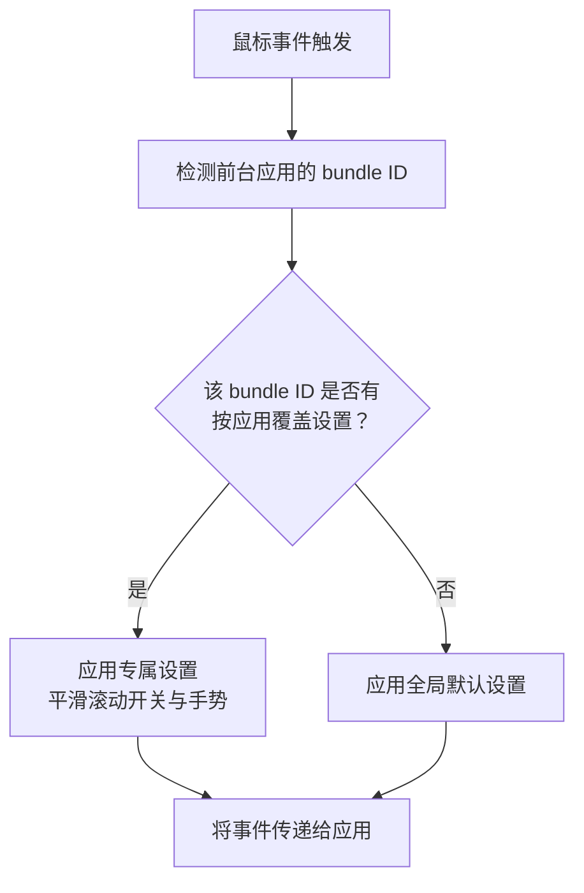

import ThemedImage from '@theme/ThemedImage';
import useBaseUrl from '@docusaurus/useBaseUrl';

# 按应用覆盖鼠标设置 {#app-scoped-overrides}

一套鼠标设置未必适合所有应用。浏览器中舒适的平滑滚动，在 Xcode 中可能并不合适；编辑器里常用的手势也未必适合其他应用。按应用覆盖设置能让特定应用采用专属行为，其余应用继续使用全局默认设置。

## 哪些设置可以按应用覆盖 {#what-you-can-override-per-app}

- **平滑滚动开关**——为应用单独开启或关闭 **Smooth Scroll**。Min Step、Speed Gain、Duration 三个手感参数和反向滚动开关仍为全局设置；只有平滑滚动的开关状态可按应用覆盖。
- **手势**——为特定应用单独设置单击、长按和方向拖动等动作，覆盖全局配置。

滚动手感参数和反向滚动开关是全局设置。**Pointer Speed**（指针速度）按设备保存，不按应用保存。应用专属的单击和其他按键动作通过手势覆盖设置配置。

<ThemedImage
  alt={"LinguaX Mouse Settings：Global 标签与 Chrome、Finder、WeChat 等应用专属覆盖标签位于同一行"}
  sources={{
    light: useBaseUrl('/img/linguax-mouse-settings.png'),
    dark: useBaseUrl('/img/linguax-mouse-settings-dark.png'),
  }}
  width="420"
/>

## 配置步骤 {#configuration-steps}

1. 打开 Mouse+ 中的应用范围切换器。
2. 选择要自定义的应用。运行中应用列表会随应用启动或退出自动刷新。
3. 为该应用切换 **Smooth Scroll**，或设置手势行为。
4. 其他应用继续使用全局默认设置。

尽量减少覆盖规则：只在全局行为不合适时添加。少量明确的覆盖规则更便于维护。关于覆盖设置与全局设置的解析方式，请见[规则与优先级](/zh-Hans/docs/concepts/rules-and-priority)。

## 相关文档 {#related-docs}

- [Mouse+ 概览](/zh-Hans/docs/mouse-plus/overview)
- [规则与优先级](/zh-Hans/docs/concepts/rules-and-priority)
