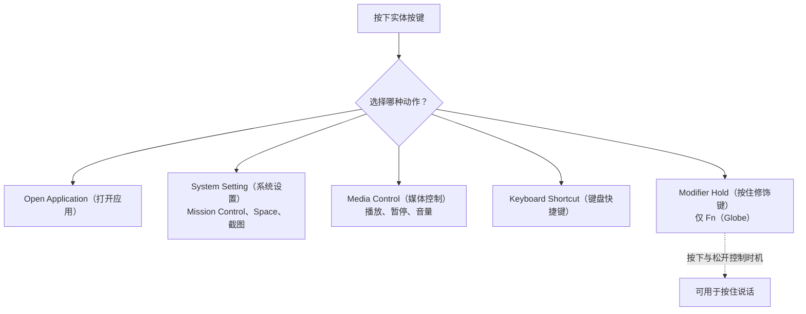

import ThemedImage from '@theme/ThemedImage';
import useBaseUrl from '@docusaurus/useBaseUrl';

# 鼠标按键与侧键映射 {#button--side-button-mapping}

macOS 默认未充分利用多数鼠标附加按键。Mouse+ 可将设备支持的侧键、滚轮倾斜和拇指键转换为实用动作：前进与后退、启动应用、窗口控制、媒体控制，或录制的快捷键。

## 可映射的按键 {#mappable-buttons}

Mouse+ 会按设备提供命名槽位：

- `Middle`（滚轮单击）；主按键 `Left Button` 和 `Right Button` 不可配置。
- `Side 1`–`Side 4`（侧键）。
- `Wheel Tilt Left` / `Wheel Tilt Right`——滚轮向左或向右倾斜，属于水平滚动输入。
- 支持该输入的 MX Master 和 MX Anywhere 型号上的 `Scroll Mode` 槽位，用于滚轮模式键。
- MX Master 型号上的 `Thumb` 槽位，位于拇指托附近；MX Anywhere 没有这个拇指键。
- Logi Lift、POP Mouse 和 MX Master 4 的 `Thumb` 槽位，对应的实体按键不同，位置请见各型号指南。
- 设备公开额外按键时提供 `Extra 1`–`Extra 5`。

已识别鼠标会在检测后自动应用侧键映射，减少手动设置。

## 动作类型 {#action-types}

鼠标按键和手势可触发以下动作类型：

- **Open Application**（打开应用）——打开指定应用。
- **System Setting**（系统设置）——窗口控制、Mission Control、Switch Space Left/Right、Control Center、Notification Center、截图、Finder 操作和开发者工作流。
- **Media Control**（媒体控制）——播放和音量，集中在独立的 Media Control 分类中。
- **Keyboard Shortcut**（键盘快捷键）——通过内置录制器录制组合键，包括普通单键和系统保留键。
- **Modifier Hold**（按住修饰键）——按住鼠标键期间模拟按住 Fn（Globe），详见下文。

<ThemedImage
  alt={"LinguaX Mouse Settings 对话框：Global 与应用范围、按键槽位 M / ML / MR / S1 / S2 / T，以及 T 槽位的 Click → Launchpad 映射"}
  sources={{
    light: useBaseUrl('/img/linguax-mouse-settings.png'),
    dark: useBaseUrl('/img/linguax-mouse-settings-dark.png'),
  }}
  width="420"
/>

需要基于 AppleScript 的自定义动作时，请查看[快捷键与热键](/zh-Hans/docs/concepts/shortcut-and-hotkeys)；Custom Script 属于键盘快捷键编辑器提供的动作，并非鼠标动作类型。

## 按住修饰键 {#modifier-hold}

按住鼠标键期间，可以持续模拟按住 **Fn（Globe）**修饰键，松开鼠标键时立即释放。这是按住说话的基础：按下时注入 Fn/Globe 修饰键，交由已配置的 macOS Dictation（听写）处理，松开时撤销。LinguaX 本身不录音。详见[使用鼠标按键按住说话](/zh-Hans/docs/push-to-talk/push-to-talk-voice-typing-mac)。

## 相关文档 {#related-docs}

- [如何映射 macOS 鼠标侧键](/zh-Hans/docs/mouse-plus/recipes/map-mouse-side-buttons-macos)
- [手势映射](/zh-Hans/docs/mouse-plus/fundamentals/gesture-mapping)
