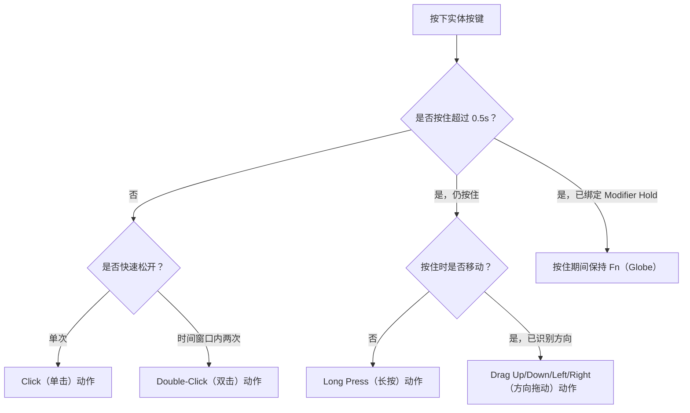

import ThemedImage from '@theme/ThemedImage';
import useBaseUrl from '@docusaurus/useBaseUrl';

# 鼠标手势映射 {#gesture-mapping}

一个按键可以完成多种操作。Mouse+ 能识别同一按键上的不同手势，并分别绑定动作，让一个侧键服务于多个工作场景。

## 手势类型 {#gesture-types}

- **Click**（单击）——按下一次。
- **Double-Click**（双击）——检测时间窗口与系统设置协调，让双击节奏更自然。
- **Long Press**（长按）——按住超过 0.5s 后触发独立动作。`Thumb` 槽位的长按仅在 Logitech HID++ 设备上可用。
- **Drag Up / Drag Down / Drag Left / Drag Right**（向上、下、左、右拖动）——按住按键并向对应方向移动；四个方向可分别映射。
- **Modifier Hold**（按住修饰键）——按住鼠标键期间模拟按住 Fn（Globe），详见下文。

<ThemedImage
  alt={"LinguaX Side 2 手势选择器：同一按键可配置 Click、Double-Click、Drag Up / Down / Left / Right、Long Press 和 Modifier Hold"}
  sources={{
    light: useBaseUrl('/img/linguax-mouse-gesture-mapping.png'),
    dark: useBaseUrl('/img/linguax-mouse-gesture-mapping-dark.png'),
  }}
  width="420"
/>

方向拖动（滑动手势）支持三种触发模式：**Release**（松开时触发）、**Threshold**（达到阈值时触发）和 **Interval**（按间隔触发）。手势进行时，屏幕会显示模式指示。侧键、长按与手势共用统一的运行时处理路径，让不同设备上的行为保持一致。滚轮倾斜槽位仅支持 **Click**。

## 绑定动作 {#binding-actions}

各手势使用鼠标动作集：**Open Application**（打开应用）、**System Setting**（系统设置）、**Media Control**（媒体控制）、**Keyboard Shortcut**（键盘快捷键）和 **Modifier Hold**（按住修饰键）。可在同一按键上组合手势，例如单击后退、长按打开 Mission Control、向左或向右拖动切换 Space。

## 按住修饰键手势 {#modifier-hold-gesture}

按住鼠标键期间，**Modifier Hold** 可持续模拟按住 **Fn（Globe）**，松开时立即释放。它适用于按住说话和使用相同 Fn 触发方式的工具。界面仅提供 Fn；该动作注入修饰键，本身不负责录音。

## 相关文档 {#related-docs}

- [鼠标按键与侧键映射](/zh-Hans/docs/mouse-plus/fundamentals/button-mapping)
- [快捷键与热键](/zh-Hans/docs/concepts/shortcut-and-hotkeys)
