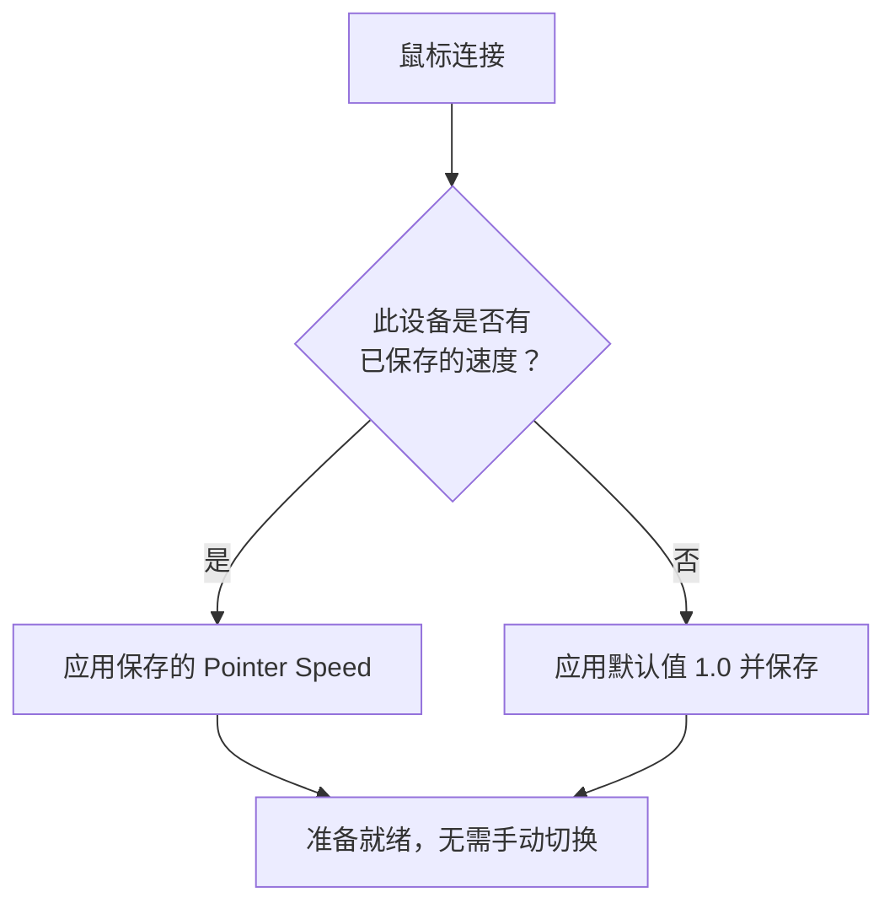

import ThemedImage from '@theme/ThemedImage';
import useBaseUrl from '@docusaurus/useBaseUrl';

# 指针速度与加速度 {#pointer-speed--acceleration}

macOS 为第三方鼠标提供的指针控制较有限，系统滑块通常由设备共用。Mouse+ 在独立的 **Feel Adjustment**（手感调整）区块中提供更细致的控制。

## Pointer Speed（指针速度） {#pointer-speed}

Feel Adjustment 只有一个 **Pointer Speed** 滑块，范围为 0.1–5.0，默认 1.0，用于调整 macOS 系统界面范围之外的指针响应。设置通过底层系统接口即时生效，无需重启应用，因此可以边移动指针边调整。较低数值会让指针更慢、更稳，适合需要精细操作的用户。此滑块不提供独立的关闭加速度开关，也不是硬件 DPI 滑块。另见 [Mac 鼠标加速度设置指南](/zh-Hans/docs/mouse-plus/recipes/disable-mouse-acceleration-mac)。

兼容 Logitech 鼠标还可通过 HID++ 调整硬件 DPI。这是一项独立能力，与 macOS 的 Pointer Speed 设置不同。

## 按设备保存 {#per-device-persistence}

每台鼠标的 Pointer Speed 会按设备保存。桌面鼠标和便携鼠标可以分别记住不同数值；设备连接后，Mouse+ 会自动应用对应配置，无需手动切换。相同型号的两台设备（相同 VID:PID）无法区分，因此会共用一份配置。

<ThemedImage
  alt={"LinguaX 鼠标控制中的按设备 Pointer Speed 设置；兼容 Logitech 鼠标的硬件 DPI 单独配置"}
  sources={{
    light: useBaseUrl('/img/linguax-pointerspeed-dpi-reverse-scroll.png'),
    dark: useBaseUrl('/img/linguax-pointerspeed-dpi-reverse-scroll-dark.png'),
  }}
  width="420"
/>

## 相关文档 {#related-docs}

- [平滑滚动](/zh-Hans/docs/mouse-plus/fundamentals/smooth-scrolling)
- [设备兼容性](/zh-Hans/docs/mouse-plus/device-compatibility)
