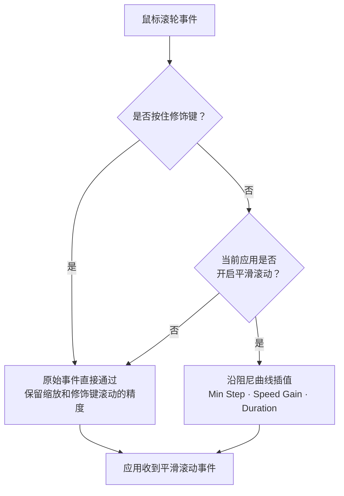

import ThemedImage from '@theme/ThemedImage';
import useBaseUrl from '@docusaurus/useBaseUrl';

# 平滑滚动 {#smooth-scrolling}

多数第三方鼠标在 macOS 上按滚轮刻度逐格滚动，内容一行行跳动。Mouse+ 会捕获这些滚动事件并沿平滑曲线重新输出，让长网页和代码的滚动更接近触控板的连贯体验。

## 工作原理 {#how-it-works}

Mouse+ 在原始滚动信号到达应用前重新处理它，通过阻尼曲线插值，将离散滚轮刻度转换为连续运动。关闭或绕过平滑处理时，仍保留原始滚动距离，不会丢失滚动行程。

<ThemedImage
  alt={"LinguaX Smooth Scroll 面板：Min Step、Speed Gain、Duration 滑块，以及按住 ⌘⌥⌃⇧ 或 Fn 会暂停平滑滚动的说明"}
  sources={{
    light: useBaseUrl('/img/linguax-smooth-scroll.png'),
    dark: useBaseUrl('/img/linguax-smooth-scroll-dark.png'),
  }}
  width="420"
/>

## 设置 {#settings}

三个全局滑块控制滚动手感：

- **Min Step**（最小步长）——每次事件应用的最小滚动步长，范围 1.0–100.0，默认 33.6。降低数值可获得更细小的移动，提高数值会增加单次移动幅度。
- **Speed Gain**（速度增益）——缩放每次滚动的移动距离，范围 1.0–10.0，默认 2.70。提高数值可更快移动页面，降低数值便于精细控制。
- **Duration**（持续时间）——控制惯性滑行曲线长度，范围 1.0–5.0，默认 4.35。较高数值会延长滑行，较低数值会更快停止。

这三个参数都是全局设置，应用于所有应用。

平滑处理仅作用于鼠标滚轮。触控板滚动会直接通过，保留原生连续手势行为。按住任一修饰键（`⌘`、`⌥`、`⌃`、`⇧` 或 `fn`）时，平滑处理会临时暂停，让缩放等修饰键滚动操作保持精确。

建议每次只改一个值，并在最常用的应用中测试几分钟后再调整。适中的 Speed Gain 与 Duration 通常适合阅读和编程。

## 按应用覆盖 {#per-app-overrides}

浏览器和代码编辑器对滚动的需求可能不同。你可以按应用开启或关闭平滑滚动。Min Step、Speed Gain、Duration 和反向滚动开关仍是全局设置。详见[按应用覆盖鼠标设置](/zh-Hans/docs/mouse-plus/fundamentals/app-scoped-overrides)。

## 反转滚动方向 {#reverse-scroll-direction}

Mouse+ 可以单独反转鼠标滚动方向，而不影响触控板。**Reverse Vertical Scroll**（反转垂直滚动）和 **Reverse Horizontal Scroll**（反转水平滚动）是两个独立的全局开关，每个轴可分别设置。详见[仅反转鼠标滚动方向](/zh-Hans/docs/mouse-plus/recipes/reverse-scroll-direction-mouse-only-mac)。

## 相关文档 {#related-docs}

- [修复 macOS 鼠标滚动卡顿](/zh-Hans/docs/mouse-plus/recipes/fix-choppy-mouse-scrolling-macos)
- [按应用覆盖鼠标设置](/zh-Hans/docs/mouse-plus/fundamentals/app-scoped-overrides)
