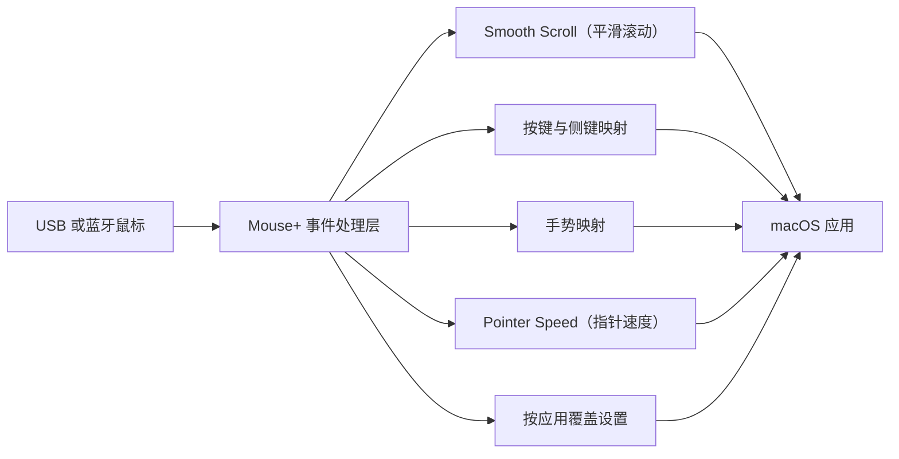

import ThemedImage from '@theme/ThemedImage';
import useBaseUrl from '@docusaurus/useBaseUrl';

# Mouse+：macOS 鼠标增强 {#mouse--mouse-enhancement-for-macos}

Mouse+ 让第三方鼠标在 macOS 上拥有更自然的手感：平滑滚动、侧键与手势动作，以及按应用覆盖的平滑滚动开关和手势设置。这些功能都集中在一个轻量应用中，无需驱动。基础功能适用于 USB 或蓝牙鼠标，特殊按键能力取决于型号。

LinguaX 是一款约 10 MB 的原生 macOS 应用。无需 Electron 运行时或账号，不收集行为遥测，也不在内核层安装任何组件。连接 USB 或蓝牙鼠标后，即可使用基础鼠标增强。

<ThemedImage
  alt={"LinguaX Mouse+ 面板：顶部为应用范围切换器，下方为 MX Master 3S 鼠标图示，点击支持的按键即可配置"}
  sources={{
    light: useBaseUrl('/img/linguax-mouse-gesture-mapping.png'),
    dark: useBaseUrl('/img/linguax-mouse-gesture-mapping-dark.png'),
  }}
  width="420"
/>

## Mouse+ 提供哪些功能 {#what-mouse-does}

- **[平滑滚动](/zh-Hans/docs/mouse-plus/fundamentals/smooth-scrolling)**——将第三方鼠标逐格跳动的滚动，转换为可调节的平滑曲线。
- **[按键与侧键映射](/zh-Hans/docs/mouse-plus/fundamentals/button-mapping)**——将设备支持的侧键、滚轮倾斜和拇指键映射为启动应用、系统控制、媒体控制和快捷键。
- **[手势映射](/zh-Hans/docs/mouse-plus/fundamentals/gesture-mapping)**——为单击、双击、长按和方向拖动配置动作。
- **[指针速度与加速度](/zh-Hans/docs/mouse-plus/fundamentals/pointer-speed)**——通过底层系统接口调整指针响应，即时生效。
- **[按应用覆盖设置](/zh-Hans/docs/mouse-plus/fundamentals/app-scoped-overrides)**——为 Xcode、Figma 或浏览器分别配置平滑滚动开关和手势行为。
- **[设备兼容性](/zh-Hans/docs/mouse-plus/device-compatibility)**——基础功能适用于 USB 或蓝牙鼠标；22 款型号提供增强识别，主要为 Logitech，包括 MX Master、G502 和 M720 等。

## 为什么选择原生轻量应用 {#why-native--lightweight}

- **约 10 MB，原生实现。**无需 Electron 或内置浏览器引擎。
- **无需账号，不收集行为遥测。**核心鼠标与输入法功能在本机运行。AIx 仅在你调用并同意传输时发送提交的文本；下载、更新和许可验证使用网络服务。启用 LinguaX 的 iCloud 后可同步配置。
- **支持睡眠与唤醒恢复。**蓝牙设备会在睡眠后自动恢复，关键服务会在系统唤醒时刷新。
- **无需驱动。**不在系统层安装组件，删除应用即可卸载。

## 相关文档 {#related-docs}

- [首次运行](/zh-Hans/docs/getting-started/first-run)
- [如何映射 macOS 鼠标侧键](/zh-Hans/docs/mouse-plus/recipes/map-mouse-side-buttons-macos)
- [macOS 的 Logi Options+ 替代方案](/zh-Hans/docs/comparisons/logi-options-plus-alternative-macos)
- [Mac 的 BetterMouse 替代方案](/zh-Hans/docs/comparisons/bettermouse-alternative-mac)
- [Mos、LinearMouse 与 Mac Mouse Fix 对比](/zh-Hans/docs/comparisons/mos-vs-linearmouse-vs-mac-mouse-fix)
