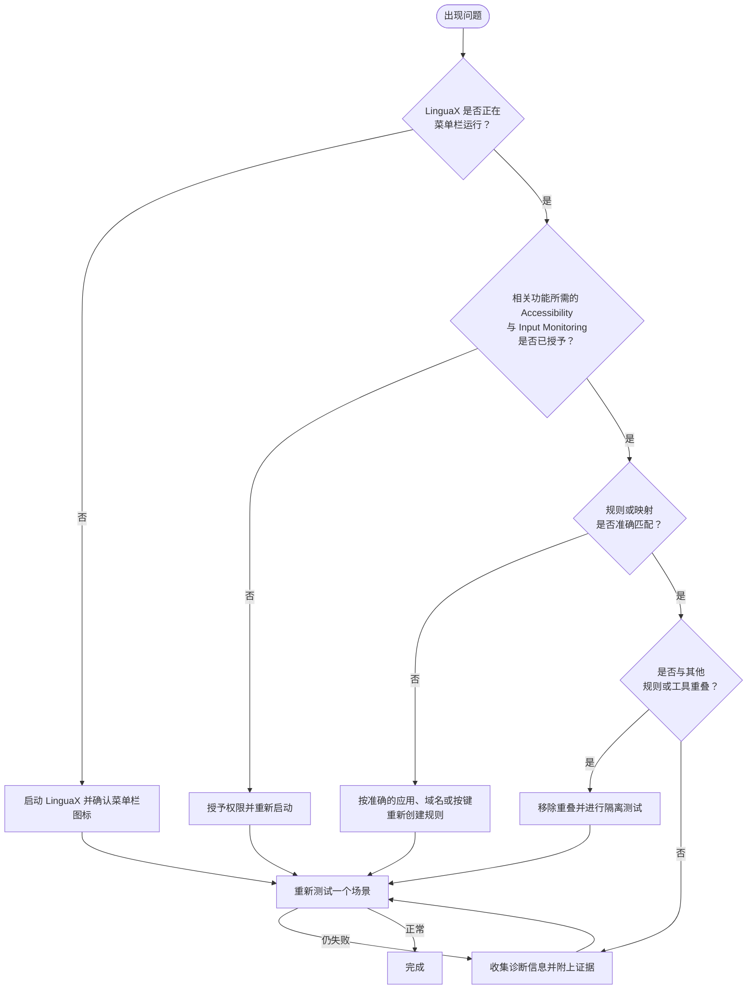

本页整理 LinguaX 的常见问题，并提供可逐步执行的恢复顺序。

## 鼠标相关问题 {#mouse-related-problems}

Mouse+ 是 LinguaX 的核心模块之一。滚动、侧键、手势、指针速度和设备识别问题请查看专门的指南：

- [鼠标问题排查](/zh-Hans/docs/troubleshooting/mouse-issues)

**刚安装 LinguaX，按键就不工作了？**如果装有 Logi Options+、Mac Mouse Fix 或其他鼠标工具，它们可能先于 LinguaX 截获事件。请查看[解决 macOS 鼠标工具冲突](/zh-Hans/docs/troubleshooting/conflicts-with-other-tools#mouse-utility-conflict)。通常可先撤销另一个工具的 Input Monitoring（输入监控）权限。

下面的内容重点排查输入法自动切换与动作自动化。

## 1）输入法不切换 {#1-input-source-does-not-switch}

快速检查：

- LinguaX 是否正在菜单栏运行。
- 规则是否启用。
- 应用或域名是否准确匹配。

修复步骤：

1. 为出问题的场景只保留一条规则。
2. 移除重叠规则。
3. 切换到其他应用后再切回测试。

## 2）浏览器域名规则不触发 {#2-browser-domain-rule-does-not-trigger}

快速检查：

- 是否选择了正确的浏览器。
- 域名是否填写正确。
- 规则是否启用。

修复步骤：

1. 用准确域名重新创建规则。
2. 保持浏览器应用默认规则简单。
3. 使用两个明显不同的域名重新测试。

## 3）快捷键脚本动作失败 {#3-shortcut-script-action-fails}

快速检查：

- 快捷键是否被其他应用截获。
- 脚本动作映射是否正确。

修复步骤：

1. 先运行一个内置模板。
2. 在 macOS 显示 Automation（自动化）提示时批准对应操作。
3. 再次运行自定义 AppleScript。

## 4）更新后行为改变 {#4-behavior-changed-after-update}

快速检查：

- 重启 LinguaX。
- 查看版本说明中是否有迁移提示。

修复步骤：

1. 等待首次启动的数据迁移完成。
2. 只用最少规则重新测试。
3. 逐步恢复其他规则。

## 5）权限相关问题 {#5-permission-related-problems}

修复步骤：

1. 在 macOS 设置中重新开启缺失的权限。
2. 重新启动 LinguaX。
3. 测试一条应用规则和一条域名规则。

## 推荐排查顺序 {#recommended-debug-order}

1. 确认应用运行状态。
2. 检查权限。
3. 确认应用和域名准确匹配。
4. 清理重叠规则。
5. 用最小场景重新测试。

仅按应用切换输入法无需 Accessibility；网站域名规则需要该权限。

## 仍未解决？ {#still-not-resolved}

- [macOS 权限](/zh-Hans/docs/troubleshooting/permissions-on-macos)
- [应用与网站规则](/zh-Hans/docs/input-source/app-and-website-rules)
- [日志与诊断](/zh-Hans/docs/troubleshooting/logs-and-diagnostics)
