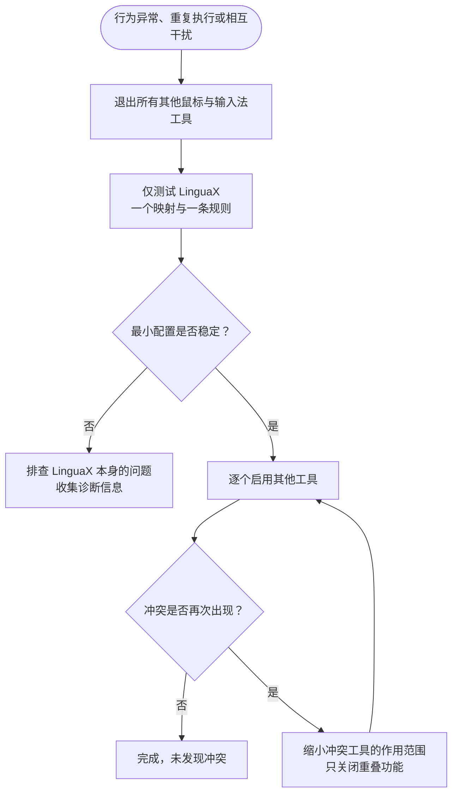

LinguaX 与其他鼠标工具或输入自动化工具同时运行时，可能发生冲突。多个工具都能截获同一批底层鼠标与键盘事件，因此每类功能应只由一个工具负责。

## 鼠标工具冲突 {#mouse-tool-conflicts}

**Logi Options+**、**Mos**、**LinearMouse**、**BetterMouse** 和 **Mac Mouse Fix** 也会处理滚动、按键映射和指针行为。与 LinguaX 同时运行可能出现：

- 滚动被重复平滑处理、卡顿或方向异常。
- 侧键或手势动作执行两次，或被另一个工具覆盖。
- 两个工具互相改变指针速度。
- 某个按键只在部分应用中有效，因为其他工具先截获了事件。

### 隔离测试：鼠标 {#isolation-test-mouse}

1. 退出其他鼠标工具，包括仅在菜单栏或登录项中运行的工具。
2. 只保留 LinguaX 运行。
3. 测试平滑滚动、一个侧键映射和一个手势。

如果表现恢复稳定，通常说明存在鼠标工具冲突。

### 缓解方法：鼠标 {#mitigation-mouse}

- 为每类功能选择唯一负责的工具：
  - 平滑滚动只由一个工具处理。
  - 按键和手势映射只由一个工具处理。
  - 指针速度只由一个工具处理。
- 如果仍需要另一个工具的其他功能，可只关闭其重叠功能。
- 避免在两个工具中同时映射同一个按键。

### 解决 macOS 鼠标工具冲突（Options+、Mac Mouse Fix 等） {#mouse-utility-conflict}

两个鼠标工具截获同一类事件时，需要让其中一个退出该事件流的处理。可以按以下顺序尝试：

#### 方案 A：撤销另一个工具的 Input Monitoring 权限（可恢复） {#option-a--revoke-input-monitoring-from-the-other-tool-reversible}

这是较快的处理方式，需要时可重新开启权限。

1. 打开 **System Settings → Privacy & Security → Input Monitoring**（系统设置 → 隐私与安全性 → 输入监控），并对 **Accessibility**（辅助功能）重复操作。

   

2. 关闭另一个工具旁的开关，保持 LinguaX 开启。

   

3. **验证：**打开 LinguaX → **Diagnostics Center**（诊断中心）→ **Realtime Events**（实时事件），按下侧键，确认能收到事件。

**注意：**另一个工具已写入设备的硬件设置，例如 Options+ 的 SmartShift、DPI 或背光，在撤销 Input Monitoring 后仍会保留，因为它们不依赖系统权限。LinguaX 提供原生的[指针速度与兼容 Logitech 设备的独立 DPI 控制](/zh-Hans/docs/mouse-plus/fundamentals/pointer-speed)，但两者是不同设置。另见[不使用 Logi Options+ 设置 MX Master 3S](/zh-Hans/docs/comparisons/mx-master-3s-mac-setup-without-logi-options)。

#### 方案 B：卸载另一个工具 {#option-b--uninstall-the-other-tool-clean-slate}

如果不再依赖该工具的其他功能，可以将其卸载，以减少后续冲突。

- **Logi Options+：**使用应用内置卸载程序，再清理残留的 LaunchAgents：`~/Library/LaunchAgents/com.logi.optionsplus.*`。完整步骤见[迁移指南](/zh-Hans/docs/comparisons/mx-master-3s-mac-setup-without-logi-options#2-quit-and-uninstall-options)。
- **Mac Mouse Fix：**在应用菜单中运行 **Uninstall**（卸载）。
- **其他工具：**参考相应厂商的卸载说明。

使用方案 A 中相同的 Diagnostics Center 步骤验证。

#### 应该选择哪种方案？ {#which-one-should-i-use}

- **撤销权限**——仍需要另一个工具的特定功能，例如设备 DPI/SmartShift、Options+ Flow 或 KVM 键盘共享。
- **卸载**——LinguaX 已覆盖你的使用需求，希望减少长期的重复配置。

## 输入法工具冲突 {#input-method-tool-conflicts}

同时运行多个输入自动化工具，例如其他输入法切换器，可能出现：

- 输入法意外切换。
- 规则执行延迟或不一致。
- 不同应用中的表现缺少明确规律。

### 隔离测试：输入法 {#isolation-test-input}

1. 退出其他输入法切换或自动化工具。
2. 只保留 LinguaX 运行。
3. 测试一条应用规则和一条浏览器域名规则。

如果表现恢复稳定，通常说明存在输入法工具冲突。

### 缓解方法：输入法 {#mitigation-input}

- 只让一个工具负责输入法切换。
- 关闭其他工具中重叠的自动切换功能。
- 避免跨工具创建重复规则。

## 恢复顺序 {#recovery-sequence}

鼠标与输入法工具冲突都可按以下顺序处理：

1. 将 LinguaX 简化为最小配置：一个映射，或一条应用/域名规则。
2. 确认仅运行 LinguaX 时表现稳定。
3. 逐个重新启用其他工具。
4. 冲突再次出现时，缩小该工具的作用范围，只关闭重叠功能。

## 相关文档 {#related-docs}

- [鼠标问题排查](/zh-Hans/docs/troubleshooting/mouse-issues)
- [常见问题排查](/zh-Hans/docs/troubleshooting/common-issues)
- [macOS 权限](/zh-Hans/docs/troubleshooting/permissions-on-macos)
- [日志与诊断](/zh-Hans/docs/troubleshooting/logs-and-diagnostics)
