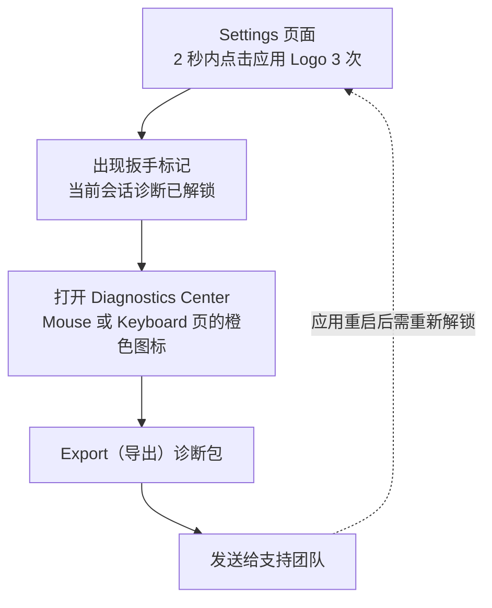

import ThemedImage from '@theme/ThemedImage';
import useBaseUrl from '@docusaurus/useBaseUrl';

完善的诊断信息能明显缩短问题处理时间。

## 如何在正式版启用诊断 {#how-to-enable-diagnostics-in-release-build}

### 从设置中解锁当前会话 {#session-unlock-from-settings}

1. 打开 LinguaX，进入 **Settings**（设置）页面。
2. 在 **2 秒内至少点击应用 Logo 3 次**。
3. Logo 上出现扳手标记后，当前会话的诊断功能即已启用。
4. 前往 **Mouse** 或 **Keyboard** 页面，点击橙色手指图标 **Diagnostics Center**（诊断中心），导出诊断信息并发送给支持团队。

说明：

- 诊断解锁为**临时会话设置**，重启应用后会重置。
- 无需运行终端命令。
- 旧版终端开关方式已弃用，在较新的 macOS 环境下可能无法可靠工作。

<ThemedImage
  alt={"Diagnostics Center 诊断中心：运行更新前"}
  sources={{
    light: useBaseUrl('/img/linguax-diagnostics-before.png'),
    dark: useBaseUrl('/img/linguax-diagnostics-before-dark.png'),
  }}
  width="256"
/>

<ThemedImage
  alt={"Diagnostics Center 诊断中心：运行更新后"}
  sources={{
    light: useBaseUrl('/img/linguax-diagnostics-after.png'),
    dark: useBaseUrl('/img/linguax-diagnostics-after-dark.png'),
  }}
  width="256"
/>

## 需要收集的信息 {#what-to-collect}

- LinguaX 版本。
- macOS 版本。
- 受影响的应用或浏览器名称。
- 受影响域名（如果与网站规则相关）。
- 问题发生时间。
- 预期行为与实际行为的准确区别。
- 简洁的复现步骤。

## 复现步骤模板 {#reproduction-template}

1. 打开 `<应用或网站>`。
2. 从 `<场景 A>` 切换到 `<场景 B>`。
3. 实际结果：`<发生了什么>`。
4. 预期结果：`<应该发生什么>`。

## 规则快照清单 {#rule-snapshot-checklist}

联系支持前，请记录：

- 预期触发的应用规则。
- 预期触发的域名规则（如有）。
- 任何范围较广或重叠的规则。

## 建议附上的证据 {#evidence-to-attach}

- 相关规则设置截图。
- 简短录屏。
- 应用内错误提示的完整原文。

请避免分享敏感个人数据。

## 联系支持前的最小验证 {#minimal-validation-before-contacting-support}

1. 重启 LinguaX。
2. 测试一条简化规则。
3. 重新测试原始场景。

如果问题仍存在，请发送收集到的诊断信息。

## 反馈奖励 {#feedback-reward-policy}

如果你的反馈被采纳并在版本中发布，LinguaX 将赠送 1 年许可。

## 相关文档 {#related-docs}

- [鼠标问题排查](/zh-Hans/docs/troubleshooting/mouse-issues)
- [常见问题排查](/zh-Hans/docs/troubleshooting/common-issues)
- [macOS 权限](/zh-Hans/docs/troubleshooting/permissions-on-macos)
- [与其他工具的冲突](/zh-Hans/docs/troubleshooting/conflicts-with-other-tools)
