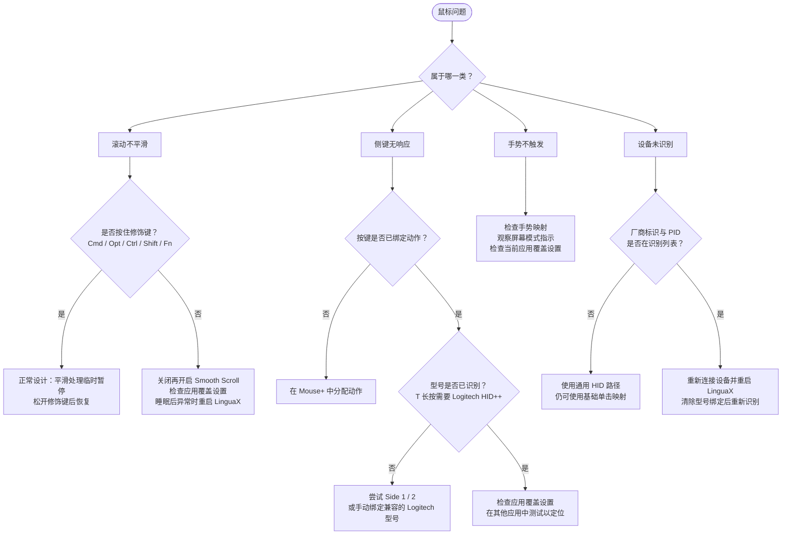

# 鼠标问题排查 {#mouse-issues}

Mouse+ 鼠标增强是 LinguaX 的核心能力之一。本页按症状整理常见鼠标问题，每项都遵循**症状 → 检查 → 修复**的顺序。

如果问题像是权限导致，请先查看 [macOS 权限](/zh-Hans/docs/troubleshooting/permissions-on-macos)。如果同时运行其他鼠标工具，请先查看[与其他工具的冲突](/zh-Hans/docs/troubleshooting/conflicts-with-other-tools)。

## 滚动不平滑或停止工作 {#scrolling-is-not-smooth-or-stops-working}

症状：滚动呈阶梯状，或使用一段时间、睡眠后失去平滑效果。

检查：

- 全局已开启平滑滚动，受影响应用的 **Smooth Scroll** 开关也处于开启状态。
- 当前应用没有关闭平滑滚动的覆盖规则。
- 已授予 **Accessibility** 和 **Input Monitoring**；平滑滚动需要鼠标事件 tap。
- 使用的是鼠标滚轮；触控板滚动会按设计直接通过，不作修改。

修复：

1. 关闭一次 **Smooth Scroll** 后再开启。
2. 确认当前应用的 **Smooth Scroll** 覆盖设置没有关闭平滑处理。Min Step、Speed Gain、Duration 和反向滚动开关均为全局设置，只有 Smooth Scroll 开关可按应用覆盖。
3. 如果问题发生在睡眠唤醒后，重启 LinguaX，重新初始化事件 tap 和 HID 服务。
4. 在简单应用（例如 Finder 或 TextEdit）中重新测试，确认基础功能正常。
5. 如果按住修饰键（`⌘⌥⌃⇧` 或 Fn）时平滑处理暂停，这是正常设计，松开后即恢复。

## 侧键无响应 {#side-buttons-do-not-respond}

症状：按下侧键或拇指键没有动作，或只在部分应用中有效。

检查：

- 按键映射中是否已为该按键分配动作。
- 鼠标型号是否正确识别，详见下方设备识别部分。
- 当前应用是否有手势覆盖设置截获或清除了该映射。

修复：

1. 打开按键映射，确认侧键已绑定动作。
2. 检查当前应用的手势覆盖设置，必要时修正或移除。
3. 对于拇指键（`T` 槽位），确认设备识别正确；拇指键长按依赖 Logitech HID++ 路径，需要兼容的已识别 Logitech 型号。
4. 在其他应用中测试同一按键，区分全局问题和应用专属问题。

## 手势不触发 {#gestures-do-not-trigger}

症状：滑动、长按或按住修饰键手势不稳定，或完全没有触发。

检查：

- 是否为该按键绑定了对应手势。
- 是否符合手势时序：长按需要持续按住，滑动需要明确方向。
- 当前应用是否绑定了预期的 **Drag Up / Drag Down / Drag Left / Drag Right** 动作。

修复：

1. 重新录制或确认该按键的手势映射。
2. 进行明确的方向拖动，并观察屏幕上的模式指示。
3. 对于 **Modifier Hold**，LinguaX 在按住鼠标键期间注入 **Fn（Globe）**，松开时撤销，例如用于按住说话。该动作在界面中仅提供 Fn。
4. 如果方向拖动触发错误动作，检查 **Drag Left / Drag Right** 绑定及当前应用覆盖设置。滚轮倾斜槽位（`WL`/`WR`）仅支持 **Click**。

## 指针速度不正确或被重置 {#pointer-speed-is-wrong-or-resets}

症状：指针过快或过慢，或切换鼠标后速度改变。

检查：

- **Pointer Speed** 按设备保存，各鼠标有各自配置；相同 VID:PID 的同型号设备会共用配置。
- 当前活动设备是否为你要调整的鼠标。

修复：

1. 在受影响鼠标为当前设备时调整 **Pointer Speed**，无需重启即可生效。
2. 使用多台鼠标时，分别确认各设备的速度设置。
3. 如果速度设置似乎未应用，重启 LinguaX，让底层指针速度设置重新生效。

## 设备未识别 {#device-not-recognized}

症状：鼠标未检测到，或已知型号没有自动按键映射。

检查：

- 鼠标是否已通过蓝牙、接收器或有线方式连接。
- Logitech 无线设备是否已配对且保持唤醒，以便进行 BLE HID++ 识别。
- 之前是否使用过 **Clear model binding**（清除型号绑定），重置了识别。

修复：

1. 确认设备出现在设备列表中；蓝牙鼠标还需检查电量和连接。
2. 唤醒鼠标并等待设备列表刷新，连接后列表会自动更新。
3. 如果错误地识别为其他型号，在设备设置中使用 **Clear model binding**，然后重新连接。
4. 支持型号请见[设备兼容性](/zh-Hans/docs/mouse-plus/device-compatibility)。

## 睡眠唤醒后映射失效 {#mappings-fail-after-sleepwake}

症状：Mac 唤醒后，按键、手势或平滑滚动停止工作。

检查：

- 蓝牙设备唤醒后可能需要片刻重新连接。
- 长时间运行后，事件 tap 可能超时。

修复：

1. 唤醒后等待几秒，让蓝牙设备自动恢复。
2. 如果仍未恢复，重启 LinguaX，重新初始化关键服务和权限状态。
3. 确认 **Accessibility** 和 **Input Monitoring** 仍已授予。

## 仍未解决？ {#still-not-resolved}

如果单个鼠标问题持续存在，请收集诊断信息并联系支持。

## 相关文档 {#related-docs}

- [macOS 权限](/zh-Hans/docs/troubleshooting/permissions-on-macos)
- [与其他工具的冲突](/zh-Hans/docs/troubleshooting/conflicts-with-other-tools)
- [日志与诊断](/zh-Hans/docs/troubleshooting/logs-and-diagnostics)
- [Mouse+ 概览](/zh-Hans/docs/mouse-plus/overview)
