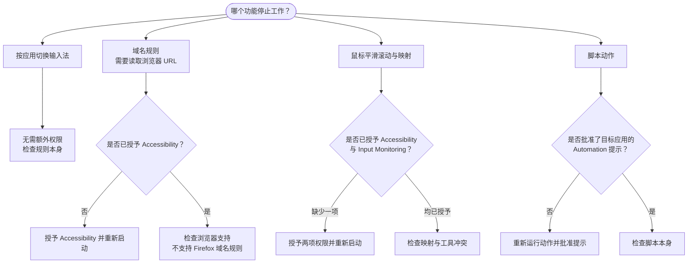

LinguaX 的鼠标功能与网站上下文识别需要对应的 macOS 权限；仅按应用切换输入法无需 Accessibility。

## 常见表现 {#common-symptoms}

- 切换应用后输入法没有变化。
- 浏览器中的域名规则表现不稳定。
- 首次运行快捷键脚本动作失败。

LinguaX 的常规权限设置包含以下两项：

## 所需权限 {#required-permissions}

- **Accessibility**（辅助功能）——用于鼠标事件 tap、平滑滚动、指针速度、模拟按键，以及读取前台浏览器标签页 URL 来匹配网站规则。
- **Input Monitoring**（输入监控）——用于 HID 设备管理。

> 按应用切换输入法无需 Accessibility；读取浏览器 URL 来匹配**网站域名规则**需要 Accessibility。

## 必要检查 {#required-checks}

1. 打开 LinguaX 的权限状态设置。
2. 打开 macOS **System Settings**（系统设置），确认所需权限已启用。
3. 更改权限后重新启动 LinguaX。

## 关于脚本动作的权限提示 {#about-script-action-prompts}

脚本动作控制其他应用（例如 System Events 或 Finder）时，macOS 可能另外显示 Automation（自动化）授权提示。

批准对应提示后，相关脚本动作才能执行。

## 恢复流程 {#recovery-flow}

1. 退出 LinguaX。
2. 重新打开 LinguaX。
3. 重新授予缺失的权限。
4. 测试一条应用规则。
5. 测试一条域名规则。
6. 如使用脚本动作，再运行一次内置模板。

## 更新后注意事项 {#post-update-note}

部分版本包含存储架构升级。升级后首次启动时，数据迁移可能需要额外时间，请等待迁移完成后再验证各项功能。

## 相关文档 {#related-docs}

- [首次运行](/zh-Hans/docs/getting-started/first-run)
- [鼠标问题排查](/zh-Hans/docs/troubleshooting/mouse-issues)
- [常见问题排查](/zh-Hans/docs/troubleshooting/common-issues)
- [快捷键与热键](/zh-Hans/docs/concepts/shortcut-and-hotkeys)
