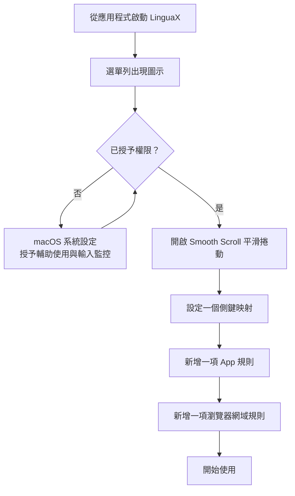

import ThemedImage from '@theme/ThemedImage';
import useBaseUrl from '@docusaurus/useBaseUrl';

安裝完成後，按照以下步驟即可在幾分鐘內開始使用 LinguaX，先從簡單設定著手。

## 首次啟動流程一覽 {#the-first-run-flow-at-a-glance}

接下來的五節會詳細介紹各個步驟。

## 步驟 1：啟動 {#step-1-launch}

1. 從「**應用程式**」開啟 LinguaX。
2. 確認選單列中顯示 LinguaX 圖示。

<ThemedImage
  alt={"macOS 選單列示意圖：LinguaX 滑鼠圖示位於電池、Wi-Fi、控制中心與時鐘旁"}
  sources={{
    light: useBaseUrl('/img/linguax-menubar-icon.svg'),
    dark: useBaseUrl('/img/linguax-menubar-icon-dark.svg'),
  }}
  width="720"
/>

## 步驟 2：授予權限 {#step-2-grant-permissions}

1. 開啟 LinguaX 的 **Settings**（設定），勾選 **Permission: Accessibility**（輔助使用）與 **Permission: Input Monitoring**（輸入監控）。
2. macOS 會自動開啟「系統設定」中的對應頁面，請開啟 LinguaX 的權限開關。
3. 返回 LinguaX，確認兩項權限都保持勾選。

輔助使用權限用於滑鼠事件處理與網站網域規則；輸入監控權限用於 HID 裝置管理。依 App 自動切換輸入法本身不需要輔助使用權限。

<ThemedImage
  alt={"LinguaX Settings 頁面，兩項 Permission: Accessibility 與 Permission: Input Monitoring 均已勾選；點選各項可開啟對應的 macOS 系統設定"}
  sources={{
    light: useBaseUrl('/img/linguax-mouse-permission.png'),
    dark: useBaseUrl('/img/linguax-mouse-permission-dark.png'),
  }}
  width="420"
/>

## 步驟 3：先體驗一項 Mouse+ 功能 {#step-3-start-with-one-mouse-win}

1. 開啟 **Smooth Scroll**（平滑捲動）。
2. 設定一項你實際會使用的滑鼠動作。
3. 確認主要 App 中的指標與捲動手感穩定。

<ThemedImage
  alt={"LinguaX Mouse+ 頁面，顯示目前裝置與可點選的按鍵映射圖"}
  sources={{
    light: useBaseUrl('/img/linguax-mouse-gesture-mapping.png'),
    dark: useBaseUrl('/img/linguax-mouse-gesture-mapping-dark.png'),
  }}
  width="420"
/>

## 步驟 4：驗證 {#step-4-verify}

1. 為主要編輯器新增一項 App 規則。
2. 新增一項瀏覽器網域規則。
3. 在不同情境間切換，確認輸入法行為正確。

<ThemedImage
  alt={"LinguaX 輸入法規則面板，顯示個別 App 的規則"}
  sources={{
    light: useBaseUrl('/img/linguax-input-method-app-mapping.png'),
    dark: useBaseUrl('/img/linguax-input-method-app-mapping-dark.png'),
  }}
  width="420"
/>

## 步驟 5：選用功能檢查 {#step-5-optional-feature-checks}

- 視需要新增第二個滑鼠映射。
- 若使用腳本動作，請先執行一個範本，並在 macOS 出現「自動化」權限提示時允許。

## 接著閱讀 {#next-reading}

- [快速導覽](/zh-Hant/docs/getting-started/quick-tour)
- [Mouse+ 概覽](/zh-Hant/docs/mouse-plus/overview)
- [App 與網站規則](/zh-Hant/docs/input-source/app-and-website-rules)
- [常見問題排解](/zh-Hant/docs/troubleshooting/common-issues)
