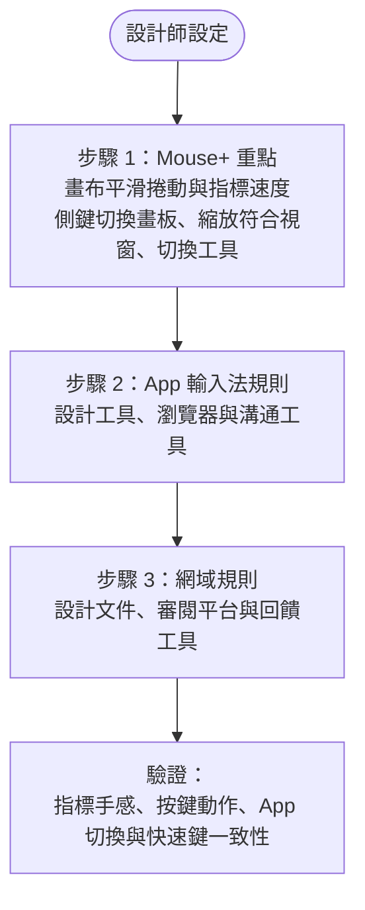

本指南適合需要穩定指標手感與快速鍵的創作工作流程。先從 Mouse+ 著手：整天使用設計工具時，精準的捲動與指標控制能立即改善操作體驗，之後再設定輸入法規則。

## 步驟 1：Mouse+ 重點設定 {#step-1-mouse-focus}

先調整最常影響操作的指標控制。

1. 為畫布、圖層清單與長畫板開啟平滑捲動。
2. 在 **Feel Adjustment**（手感調整）的 **Pointer Speed** 滑桿調整指標速度，找到穩定且可預期的手感。此設定依裝置儲存，調整 macOS 的指標反應，與硬體 DPI 不同；沒有獨立的停用加速度開關，也不保證 1:1 移動。
3. 將滑鼠按鍵映射到常用設計動作，例如：
   - 在畫板或畫面間上一頁／下一頁。
   - 縮放至符合視窗，或切換常用工具。
   - 在設計 App 與參考資料之間切換 Space 桌面。

若滑鼠支援滾輪左右傾斜，也可以映射對應的 `WL`／`WR` 槽位。

## 步驟 2：App 輸入法規則 {#step-2-app-input-source-rules}

調整好指標後，為以下 App 新增規則：

- 主要設計工具。
- 瀏覽器。
- 溝通或審閱工具。

先使用簡單的預設值，再逐步微調。

## 步驟 3：優先新增的網域規則 {#step-3-domain-rules-to-add-first}

- 設計文件網站。
- 內部審閱工具。
- 回饋平台。

## 驗證清單 {#validation-checklist}

1. 確認設計 App 中的指標與捲動手感穩定。
2. 觸發已映射的滑鼠按鍵，確認動作正常。
3. 在設計 App 與瀏覽器間切換。
4. 確認兩者的輸入法都正確，快速鍵也維持一致。

## 相關文件 {#related-docs}

- [Mouse+ 概覽](/zh-Hant/docs/mouse-plus/overview)
- [指標速度](/zh-Hant/docs/mouse-plus/fundamentals/pointer-speed)
- [App 與網站規則](/zh-Hant/docs/input-source/app-and-website-rules)
- [常見問題排解](/zh-Hant/docs/troubleshooting/common-issues)
