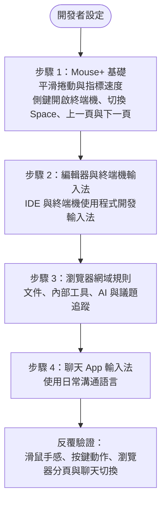

本指南適合需要在編輯器、終端機、瀏覽器與聊天 App 之間切換的開發工作。先從 Mouse+ 著手：每天都需要導覽與捲動，穩定的指標和幾個常用按鍵映射能立即提高操作效率，之後再設定輸入法規則。

## 步驟 1：Mouse+ 基礎設定 {#step-1-mouse-foundation}

先設定滑鼠。

1. 開啟平滑捲動，讓程式碼與長文件的捲動更穩定。
2. 使用 **Feel Adjustment** 中的 **Pointer Speed** 設定舒適的指標速度；此設定依裝置儲存，調整 macOS 指標反應，與硬體 DPI 不同，也不是獨立的停用加速度開關。
3. 將側鍵映射到最常重複的開發動作，例如：
   - 開啟或切換到終端機。
   - 切換 Space（左右桌面）。
   - 在瀏覽器或編輯器歷程中上一頁／下一頁。

若滑鼠支援滾輪左右傾斜，也可映射 `WL`／`WR` 槽位，例如用來切換 Space。

## 步驟 2：編輯器與終端機輸入法 {#step-2-editor--terminal-input-source}

滑鼠手感調整完成後，為最常使用的 App 新增輸入法規則。

1. 編輯器／IDE → 程式開發用輸入法（通常為純 ASCII）。
2. 終端機 → 程式開發用輸入法。

如此一來，切換到這些 App 時就能立即使用預期的輸入方式。

## 步驟 3：瀏覽器網域規則 {#step-3-browser-domain-rules}

依網域細分文件與工具網站的輸入法。

先從每天會造訪多次的網站開始：

- 文件網站。
- 內部工具。
- AI 助理。
- 議題追蹤或程式碼審閱系統。

## 步驟 4：聊天 App 輸入法 {#step-4-chat-app-input-source}

為聊天 App 指定日常溝通語言的輸入法。

## 驗證流程 {#validation-loop}

1. 確認 IDE、終端機與瀏覽器中的滑鼠行為都穩定。
2. 觸發側鍵映射，確認動作正常。
3. 在瀏覽器的兩個已設定網域間切換。
4. 在瀏覽器與聊天 App 之間切換，確認輸入法正確。

## 維護建議 {#maintenance-guidance}

- 避免重複且重疊的規則。
- 明確指定網域。
- 定期清理過時規則。

## 相關文件 {#related-docs}

- [Mouse+ 概覽](/zh-Hant/docs/mouse-plus/overview)
- [App 與網站規則](/zh-Hant/docs/input-source/app-and-website-rules)
- [多語言工作流程](/zh-Hant/docs/input-source/multilingual-workflow)
- [常見問題排解](/zh-Hant/docs/troubleshooting/common-issues)
