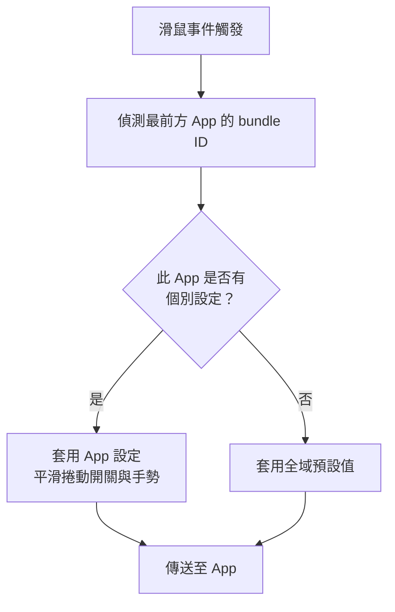

import ThemedImage from '@theme/ThemedImage';
import useBaseUrl from '@docusaurus/useBaseUrl';

# 個別 App 設定 {#app-scoped-overrides}

一組滑鼠設定未必適合所有 App。瀏覽器中舒適的平滑捲動，到了 Xcode 可能需要關閉；編輯器裡常用的手勢，也不一定適合其他情境。個別 App 設定讓指定 App 使用自己的行為，其餘 App 則沿用清楚的全域預設值。

## 哪些設定可以依 App 調整 {#what-you-can-override-per-app}

- **平滑捲動開關**：可針對 App 開啟或關閉 **Smooth Scroll**。Min Step、Speed Gain、Duration 三個手感參數與捲動方向開關維持全域設定；只有啟用狀態可依 App 調整。
- **手勢**：可為個別 App 設定點按、長按與方向拖曳動作，覆寫全域設定；按鍵的 Click 動作也透過手勢覆寫處理。

平滑捲動參數與反轉方向屬於全域設定。**Pointer Speed** 則依裝置儲存，不是個別 App 設定。

<ThemedImage
  alt={"LinguaX Mouse Settings：同一列顯示 Global 全域分頁，以及 Chrome、Finder、WeChat 等個別 App 分頁"}
  sources={{
    light: useBaseUrl('/img/linguax-mouse-settings.png'),
    dark: useBaseUrl('/img/linguax-mouse-settings-dark.png'),
  }}
  width="420"
/>

## 設定步驟 {#configuration-steps}

1. 在 Mouse+ 開啟 App 範圍切換器。
2. 選擇要自訂的 App。執行中的 App 清單會隨啟動與結束自動更新，方便找到目標。
3. 為該 App 開啟或關閉平滑捲動，或設定手勢行為。
4. 其他 App 繼續沿用全域預設值。

只在全域行為不符合需求時新增覆寫。以穩定的全域設定搭配少量例外，比大量互相競爭的規則更容易管理。關於個別設定與全域設定的套用方式，請參閱[規則與優先順序](/zh-Hant/docs/concepts/rules-and-priority)。

## 相關文件 {#related-docs}

- [Mouse+ 概覽](/zh-Hant/docs/mouse-plus/overview)
- [規則與優先順序](/zh-Hant/docs/concepts/rules-and-priority)
