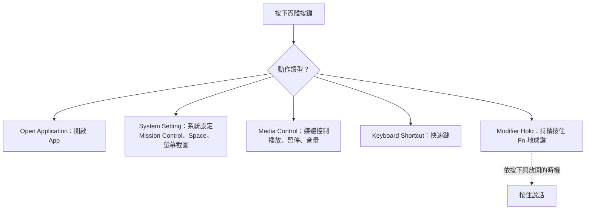

import ThemedImage from '@theme/ThemedImage';
import useBaseUrl from '@docusaurus/useBaseUrl';

# 按鍵與側鍵映射 {#button--side-button-mapping}

macOS 對許多額外滑鼠按鍵的支援有限。Mouse+ 能將側鍵、滾輪傾斜與拇指鍵變成實際動作：上一頁／下一頁、開啟 App、視窗控制、媒體鍵，或錄製的快速鍵。

## 可映射的按鍵 {#mappable-buttons}

依裝置不同，Mouse+ 會顯示以下具名槽位：

- `Left Button`、`Right Button`：左鍵與右鍵，**不可設定**。
- `Middle`：中鍵。
- `Side 1`–`Side 4`：側鍵。
- `Extra 1`–`Extra 5`：額外按鍵，依型號提供。
- `Wheel Tilt Left`／`Wheel Tilt Right`（`WL`／`WR`）：滾輪向左或向右傾斜，屬於水平捲動輸入。
- `Scroll Mode`（`SM`）：部分 MX Master 與 MX Anywhere 型號的滾輪模式鍵。
- `Thumb`（`T`）：MX Master 系列的拇指區按鍵；MX Anywhere 系列沒有這個按鍵。
- Logi Lift、POP Mouse 與 MX Master 4 也可能提供 `Thumb` 槽位；實體位置依型號不同，請參閱個別指南。

辨識成功的滑鼠會自動套用側鍵預設值，減少手動設定。

## 動作類型 {#action-types}

每個滑鼠按鍵或手勢可觸發以下其中一種動作：

- **Open Application**：開啟指定 App。
- **System Setting**：視窗控制、Mission Control、Switch Space Left/Right、控制中心、通知中心、螢幕截圖、Finder 操作與開發者工作流程。
- **Media Control**：播放與音量控制，集中在媒體控制類別中。
- **Keyboard Shortcut**：使用內建錄製器記錄按鍵組合，包含一般單鍵與系統保留鍵。
- **Modifier Hold**：按住滑鼠按鍵時持續模擬按住 Fn（地球）鍵，詳見下方。

<ThemedImage
  alt={"LinguaX Mouse Settings 對話框：全域與個別 App 範圍、按鍵槽位，以及 T 的 Click 點按映射到 Launchpad"}
  sources={{
    light: useBaseUrl('/img/linguax-mouse-settings.png'),
    dark: useBaseUrl('/img/linguax-mouse-settings-dark.png'),
  }}
  width="420"
/>

AppleScript 自訂動作透過鍵盤快速鍵編輯器設定，詳見[快速鍵與熱鍵](/zh-Hant/docs/concepts/shortcut-and-hotkeys)。滑鼠動作選單不直接提供 Custom Script。

## 持續按住修飾鍵 {#modifier-hold}

按住滑鼠按鍵時，可持續模擬按住 **Fn（地球）**鍵，放開即解除。這是按住說話的基礎：依 macOS 聽寫或語音工具的設定，用 Fn／地球鍵控制啟動與停止。LinguaX 本身不錄音，只模擬修飾鍵。目前此動作僅開放 Fn。請參閱[使用滑鼠按鍵進行按住說話語音輸入](/zh-Hant/docs/push-to-talk/push-to-talk-voice-typing-mac)。

## 相關文件 {#related-docs}

- [在 macOS 映射滑鼠側鍵](/zh-Hant/docs/mouse-plus/recipes/map-mouse-side-buttons-macos)
- [手勢映射](/zh-Hant/docs/mouse-plus/fundamentals/gesture-mapping)
