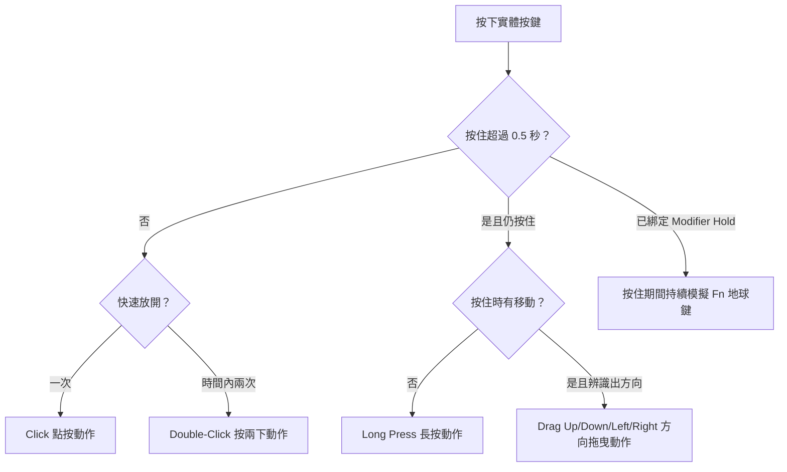

import ThemedImage from '@theme/ThemedImage';
import useBaseUrl from '@docusaurus/useBaseUrl';

# 手勢映射 {#gesture-mapping}

一個按鍵也能執行多種工作。Mouse+ 能辨識同一按鍵上的不同手勢，並分別綁定動作，讓一個側鍵支援多個工作流程。

## 手勢類型 {#gesture-types}

- **Click**（點按）：按下一次。
- **Double-Click**（按兩下）：偵測時間配合系統設定，維持自然節奏。
- **Long Press**（長按）：按住超過 0.5 秒後觸發另一個動作。`Thumb` 槽位的長按僅支援 Logitech HID++ 裝置。
- **Drag Up / Drag Down / Drag Left / Drag Right**（向上／下／左／右拖曳）：按住按鍵並朝指定方向移動，四個方向可各自映射。
- **Modifier Hold**（持續按住修飾鍵）：按住滑鼠按鍵時模擬持續按住 Fn（地球）鍵，詳見下方。

<ThemedImage
  alt={"LinguaX Side 2 手勢選擇器：同一按鍵可設定 Click、Double-Click、四個方向的 Drag、Long Press 與 Modifier Hold"}
  sources={{
    light: useBaseUrl('/img/linguax-mouse-gesture-mapping.png'),
    dark: useBaseUrl('/img/linguax-mouse-gesture-mapping-dark.png'),
  }}
  width="420"
/>

方向拖曳（滑動手勢）提供三種觸發模式：**Release**（放開）、**Threshold**（達到門檻）與 **Interval**（依間隔）。手勢進行時會在畫面顯示模式指示。側鍵、長按與手勢都由統一的執行機制處理，維持跨裝置的一致行為。滾輪傾斜槽位僅支援 Click。

## 綁定動作 {#binding-actions}

每個手勢可映射到滑鼠動作集合：Open Application、System Setting、Media Control、Keyboard Shortcut 與 Modifier Hold。同一按鍵可混用不同手勢，例如點按返回上一頁、長按開啟 Mission Control、向左或向右拖曳切換 Space。

## 持續按住修飾鍵手勢 {#modifier-hold-gesture}

持續按住滑鼠按鍵時，手勢可模擬按住 **Fn（地球）**鍵，放開便立即解除。這可搭配按住說話語音輸入，以及其他需要按住啟用、放開停止的工具。目前僅提供 Fn 修飾鍵。

## 相關文件 {#related-docs}

- [按鍵與側鍵映射](/zh-Hant/docs/mouse-plus/fundamentals/button-mapping)
- [快速鍵與熱鍵](/zh-Hant/docs/concepts/shortcut-and-hotkeys)
