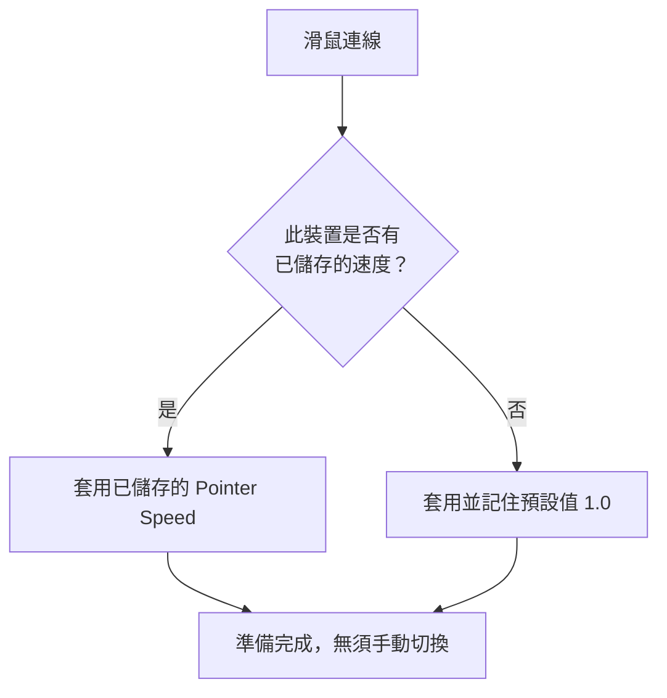

import ThemedImage from '@theme/ThemedImage';
import useBaseUrl from '@docusaurus/useBaseUrl';

# 指標速度與加速度 {#pointer-speed--acceleration}

macOS 提供的第三方滑鼠指標控制較有限。Mouse+ 在 **Feel Adjustment**（手感調整）區塊提供獨立控制。

## 指標速度 {#pointer-speed}

Feel Adjustment 區塊只有一個 **Pointer Speed** 滑桿，範圍為 0.1–5.0，預設 1.0，可調整 macOS 一般介面之外的指標反應。變更會透過底層系統介面立即生效，不需重新啟動 App；你可以一邊移動指標，一邊找到合適手感。較低的數值讓指標更慢、更穩定，適合精準操作。請參閱 [Mac 滑鼠加速度調整指南](/zh-Hant/docs/mouse-plus/recipes/disable-mouse-acceleration-mac)。

Pointer Speed 使用 macOS 的指標加速度介面，**不是硬體 DPI**，也沒有獨立的停用加速度開關。Logitech 硬體 DPI 是另一項透過 HID++ 提供的獨立功能，支援相應的 USB 與藍牙連線裝置；滾輪模式（SmartShift）切換也屬於獨立功能。

## 依裝置儲存 {#per-device-persistence}

每個滑鼠的 Pointer Speed 都會依裝置儲存。桌上型滑鼠與旅行用滑鼠可記住不同速度，裝置連線時 Mouse+ 會自動套用對應設定，不需手動切換。同型號的兩個裝置若具有相同 VID:PID，無法分別識別，因此共用同一設定。

<ThemedImage
  alt={"LinguaX 指標速度與裝置控制畫面；Feel Adjustment 的 Pointer Speed 與 Logitech 硬體 DPI 是不同設定"}
  sources={{
    light: useBaseUrl('/img/linguax-pointerspeed-dpi-reverse-scroll.png'),
    dark: useBaseUrl('/img/linguax-pointerspeed-dpi-reverse-scroll-dark.png'),
  }}
  width="420"
/>

## 相關文件 {#related-docs}

- [平滑捲動](/zh-Hant/docs/mouse-plus/fundamentals/smooth-scrolling)
- [裝置相容性](/zh-Hant/docs/mouse-plus/device-compatibility)
