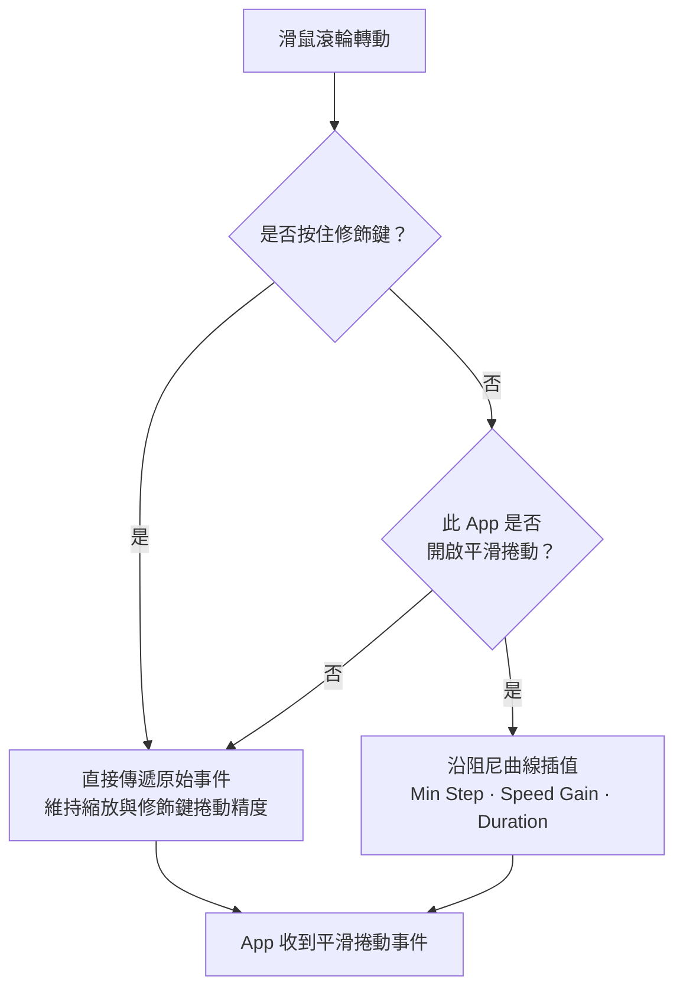

import ThemedImage from '@theme/ThemedImage';
import useBaseUrl from '@docusaurus/useBaseUrl';

# 平滑捲動 {#smooth-scrolling}

大多數第三方滑鼠在 macOS 上會逐格捲動，內容一行一行跳動，缺少流暢感。Mouse+ 攔截這些捲動事件，沿著平滑曲線重新產生動作，讓長網頁與程式碼像觸控式軌跡板般流暢。

## 運作方式 {#how-it-works}

Mouse+ 在滑鼠的原始捲動訊號到達 App 前進行處理，將離散的滾輪刻度轉換為具有阻尼的連續動作。停用或略過平滑處理時，原始捲動距離會保留。

<ThemedImage
  alt={"LinguaX Smooth Scroll 面板：Min Step、Speed Gain 與 Duration 滑桿，以及按住 ⌘⌥⌃⇧ 或 Fn 暫停平滑捲動的提示"}
  sources={{
    light: useBaseUrl('/img/linguax-smooth-scroll.png'),
    dark: useBaseUrl('/img/linguax-smooth-scroll-dark.png'),
  }}
  width="420"
/>

## 設定 {#settings}

三個全域滑桿控制手感：

- **Min Step**：每個事件的最小捲動步距，範圍 1.0–100.0，預設 33.6。降低可獲得更細緻的移動，提高則增加每次步距。
- **Speed Gain**：調整每次捲動的移動距離，範圍 1.0–10.0，預設 2.70。提高可加快頁面移動，降低則更容易精細控制。
- **Duration**：控制慣性滑行曲線的長度，範圍 1.0–5.0，預設 4.35。較高數值有更長的滑行感，較低數值則更快停止。

這三個參數都是全域設定，在所有 App 中套用相同數值。

平滑處理只作用於滑鼠滾輪，觸控式軌跡板的捲動會原樣傳遞，保留連續手勢的原生行為。按住任一修飾鍵（`⌘`、`⌥`、`⌃`、`⇧` 或 `fn`）時會暫停平滑處理，維持縮放及其他修飾鍵捲動操作的精確度。

調整建議：每次只改一個數值，在常用 App 測試幾分鐘後再調整。適中的 Speed Gain 與 Duration 通常適合閱讀和程式開發。

## 個別 App 設定 {#per-app-overrides}

瀏覽器與程式編輯器對捲動的需求可能不同。你可以依 App 開啟或關閉平滑捲動，不必全部使用同一個啟用狀態。Min Step、Speed Gain、Duration 與反轉方向開關仍維持全域設定。請參閱[個別 App 設定](/zh-Hant/docs/mouse-plus/fundamentals/app-scoped-overrides)。

## 反轉捲動方向 {#reverse-scroll-direction}

Mouse+ 可單獨反轉滑鼠捲動方向，不影響觸控式軌跡板。兩個獨立的全域開關 **Reverse Vertical Scroll**（反轉垂直捲動）與 **Reverse Horizontal Scroll**（反轉水平捲動），可分別控制兩個軸向。請參閱[只反轉滑鼠捲動方向](/zh-Hant/docs/mouse-plus/recipes/reverse-scroll-direction-mouse-only-mac)。

## 相關文件 {#related-docs}

- [修正 macOS 滑鼠捲動不順](/zh-Hant/docs/mouse-plus/recipes/fix-choppy-mouse-scrolling-macos)
- [個別 App 設定](/zh-Hant/docs/mouse-plus/fundamentals/app-scoped-overrides)
