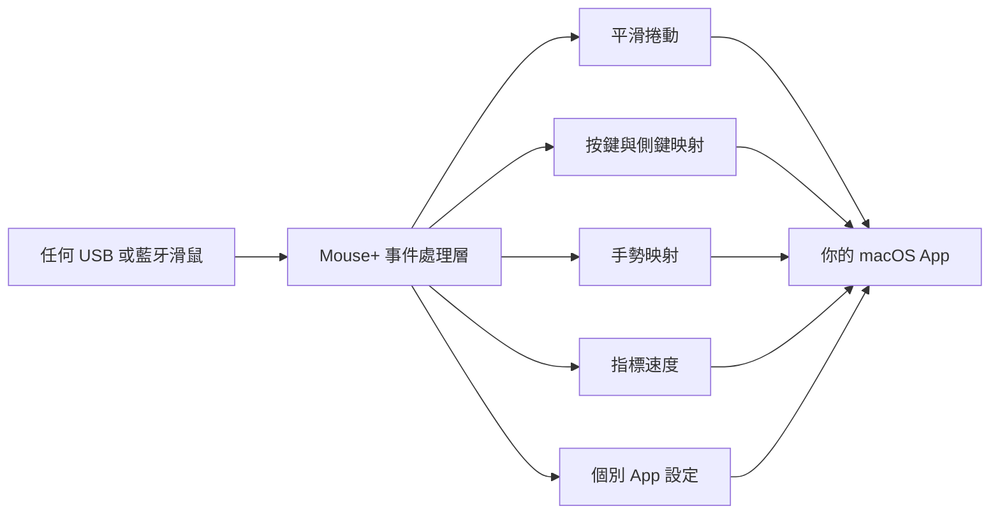

import ThemedImage from '@theme/ThemedImage';
import useBaseUrl from '@docusaurus/useBaseUrl';

# Mouse+：macOS 滑鼠增強 {#mouse--mouse-enhancement-for-macos}

Mouse+ 讓第三方滑鼠在 macOS 上擁有自然的操作手感。你可以平順捲動、將側鍵與手勢映射到實際動作，並為各個 App 設定不同的平滑捲動開關與手勢，全都在同一個輕巧、免驅動程式的 App 中完成。基礎功能適用於任何 USB 或藍牙滑鼠；特殊按鍵與型號專屬能力則視裝置而定。

這是約 10 MB 的原生 macOS App，無 Electron 執行環境、免帳號、不收集行為遙測，也不需要安裝核心延伸功能。連接 USB 或藍牙滑鼠後即可使用。

<ThemedImage
  alt={"LinguaX Mouse+ 面板：MX Master 3S，上方為 App 範圍切換器，下方滑鼠示意圖可點選以設定按鍵"}
  sources={{
    light: useBaseUrl('/img/linguax-mouse-gesture-mapping.png'),
    dark: useBaseUrl('/img/linguax-mouse-gesture-mapping-dark.png'),
  }}
  width="420"
/>

## Mouse+ 的功能 {#what-mouse-does}

- **[平滑捲動](/zh-Hant/docs/mouse-plus/fundamentals/smooth-scrolling)**：將第三方滑鼠逐格跳動的捲動，轉換為可調整的平順曲線。
- **[按鍵與側鍵映射](/zh-Hant/docs/mouse-plus/fundamentals/button-mapping)**：將側鍵、滾輪傾斜與拇指鍵映射到啟動 App、系統控制、媒體與快速鍵。
- **[手勢映射](/zh-Hant/docs/mouse-plus/fundamentals/gesture-mapping)**：為點按、按兩下、長按與方向拖曳設定動作。
- **[指標速度與加速度](/zh-Hant/docs/mouse-plus/fundamentals/pointer-speed)**：透過底層系統介面調整指標反應，立即生效。
- **[個別 App 設定](/zh-Hant/docs/mouse-plus/fundamentals/app-scoped-overrides)**：為 Xcode、Figma 或瀏覽器設定不同的平滑捲動開關與手勢。
- **[裝置相容性](/zh-Hant/docs/mouse-plus/device-compatibility)**：基礎功能適用於任何 USB 或藍牙滑鼠，另為 23 款型號提供增強辨識，主要包括 Logitech MX Master、G502、M720 等。

## 原生與輕巧的優點 {#why-native--lightweight}

- **約 10 MB，完全原生。** 無 Electron，也不內含瀏覽器引擎。
- **免帳號、不收集行為遙測。** 滑鼠與輸入法核心行為在本機執行。AIx 僅在你主動呼叫並同意傳送時提交文字；下載、更新與授權驗證會使用網路服務。
- **睡眠喚醒後持續運作。** 藍牙裝置會在睡眠後自動恢復，重要服務也會在系統喚醒時重新整理。
- **免驅動程式。** 不會在系統核心安裝元件；刪除 App 即可移除。

## 相關文件 {#related-docs}

- [首次啟動](/zh-Hant/docs/getting-started/first-run)
- [在 macOS 映射滑鼠側鍵](/zh-Hant/docs/mouse-plus/recipes/map-mouse-side-buttons-macos)
- [macOS 的 Logi Options+ 替代方案](/zh-Hant/docs/comparisons/logi-options-plus-alternative-macos)
- [Mac 的 BetterMouse 替代方案](/zh-Hant/docs/comparisons/bettermouse-alternative-mac)
- [Mos、LinearMouse 與 Mac Mouse Fix 比較](/zh-Hant/docs/comparisons/mos-vs-linearmouse-vs-mac-mouse-fix)
