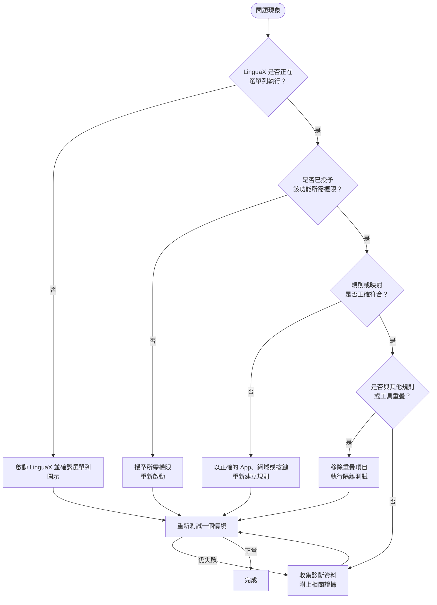

本頁整理常見的 LinguaX 問題，以及可依序操作的恢復步驟。

## 滑鼠相關問題 {#mouse-related-problems}

Mouse+ 是 LinguaX 的核心能力之一。捲動、側鍵、手勢、指標速度與裝置辨識問題，請參閱專門頁面：

- [滑鼠問題](/zh-Hant/docs/troubleshooting/mouse-issues)

**安裝 LinguaX 後，按鍵立即失效？** 如果電腦裝有 Logi Options+、Mac Mouse Fix 或其他滑鼠工具，它們可能在 LinguaX 之前攔截事件。請參閱[解決 macOS 滑鼠工具衝突](/zh-Hant/docs/troubleshooting/conflicts-with-other-tools#mouse-utility-conflict)。關閉另一個工具的「輸入監控」權限通常可解決問題。

以下章節說明輸入法切換與自動化問題。

## 1）輸入法沒有切換 {#1-input-source-does-not-switch}

快速檢查：

- LinguaX 正在選單列執行。
- 規則已啟用。
- App／網域文字完全符合。

修正步驟：

1. 只保留目前問題情境的一項規則。
2. 移除重疊規則。
3. 切換到其他 App 或網站，再切回來測試。

## 2）瀏覽器網域規則沒有觸發 {#2-browser-domain-rule-does-not-trigger}

快速檢查：

- 選擇了正確的瀏覽器。
- 網域輸入正確。
- 規則已啟用。
- 已授予 **Accessibility**（輔助使用）權限。
- 使用 Safari、Chrome、Edge、Brave 或 Opera；Firefox 不支援網域規則。

修正步驟：

1. 使用正確的網域重新建立規則。
2. 讓瀏覽器的 App 預設規則保持簡單。
3. 用兩個明顯不同的網域重新測試。

## 3）快速鍵腳本動作失敗 {#3-shortcut-script-action-fails}

快速檢查：

- 快速鍵未被其他 App 攔截。
- 腳本動作已正確映射。

修正步驟：

1. 先執行一個內建 AppleScript 範本。
2. macOS 出現「自動化」提示時，允許所需權限。
3. 再次執行自訂 AppleScript。

## 4）更新後行為改變 {#4-behavior-changed-after-update}

快速檢查：

- 重新啟動 LinguaX。
- 查看版本說明中的資料移轉注意事項。

修正步驟：

1. 等待更新後首次啟動的資料移轉完成。
2. 以最少規則重新測試。
3. 逐步加回其他規則。

## 5）權限相關問題 {#5-permission-related-problems}

修正步驟：

1. 在 macOS「系統設定」重新開啟缺少的權限。
2. 重新啟動 LinguaX。
3. 測試一項 App 規則與一項網域規則。

## 建議的排查順序 {#recommended-debug-order}

1. 確認 App 執行狀態。
2. 檢查該功能需要的權限；App 層級輸入法切換本身不需要輔助使用權限。
3. 確認 App／網域比對正確。
4. 清理重疊規則。
5. 以最簡單情境重新測試。

## 仍未解決？ {#still-not-resolved}

- [macOS 權限](/zh-Hant/docs/troubleshooting/permissions-on-macos)
- [App 與網站規則](/zh-Hant/docs/input-source/app-and-website-rules)
- [記錄與診斷](/zh-Hant/docs/troubleshooting/logs-and-diagnostics)
