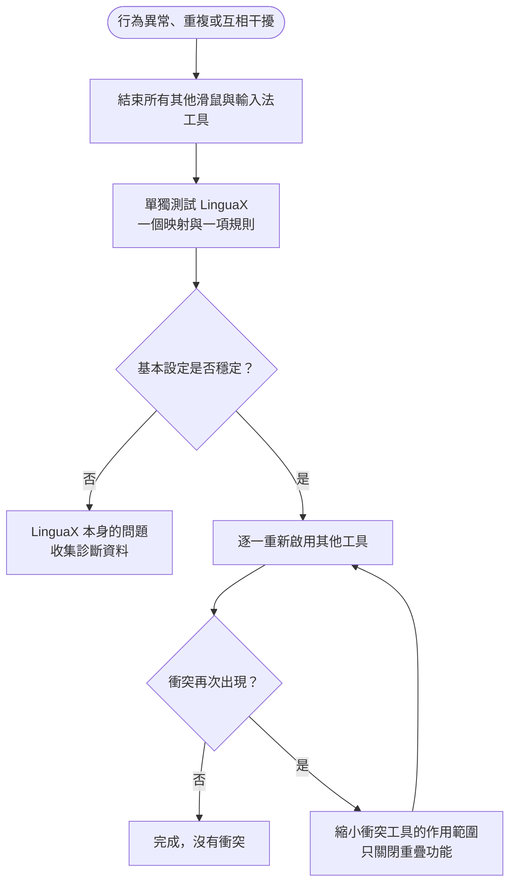

同時執行 LinguaX 與其他滑鼠工具或輸入法自動化工具，可能出現互相干擾的行為。多個工具都能攔截相同的底層滑鼠與鍵盤事件，因此每項功能應由單一工具負責。

## 滑鼠工具衝突 {#mouse-tool-conflicts}

**Logi Options+**、**Mos**、**LinearMouse**、**BetterMouse** 與 **Mac Mouse Fix** 等工具，也會處理捲動、按鍵映射與指標行為。與 LinguaX 同時執行時，可能出現：

- 捲動被重複平滑處理、卡頓或方向相反。
- 側鍵或手勢動作觸發兩次，或被另一個工具覆寫。
- 兩個工具互相改變指標速度。
- 某個按鍵只在部分 App 有效，因為另一個工具先攔截了事件。

### 隔離測試：滑鼠 {#isolation-test-mouse}

1. 結束其他滑鼠工具，包含只在選單列或登入項目中執行的工具。
2. 只保留 LinguaX 執行。
3. 測試平滑捲動、一個側鍵映射與一個手勢。

若行為恢復穩定，很可能是滑鼠工具衝突。

### 改善方式：滑鼠 {#mitigation-mouse}

- 每項功能選擇一個主要工具：平滑捲動、按鍵與手勢映射、指標速度，各自只由一個工具負責。
- 若仍需要另一個工具的其他功能，可只關閉重疊功能。
- 避免在兩個工具中同時將同一按鍵映射到動作。

### 解決 macOS 滑鼠工具衝突：Options+、Mac Mouse Fix 等 {#mouse-utility-conflict}

當兩個滑鼠工具攔截相同事件時，同一事件流程應只交給一個工具處理。可按以下順序嘗試兩種方式：

#### 方式 A：撤銷另一個工具的輸入監控權限，可隨時恢復 {#option-a--revoke-input-monitoring-from-the-other-tool-reversible}

這是最快的處理方式，日後需要時也能重新開啟。

1. 開啟「**系統設定 → 隱私權與安全性 → 輸入監控**」，並同樣檢查「**輔助使用**」。

   

2. 關閉另一個工具旁的開關，保持 LinguaX 開啟。

   

3. **驗證：**在 LinguaX 開啟 **Diagnostics Center → Realtime Events**（診斷中心 → 即時事件），按下側鍵，應可看到事件。

**注意：**另一個工具已寫入裝置的硬體設定，例如 Options+ 的 SmartShift、DPI 或背光，不會因撤銷輸入監控權限而消失，因為它們與系統權限無關。LinguaX 提供獨立的[指標速度控制](/zh-Hant/docs/mouse-plus/fundamentals/pointer-speed)，也支援相應 Logitech 裝置的硬體 DPI 與滾輪模式設定；Pointer Speed 和硬體 DPI 是不同功能。請參閱[不使用 Logi Options+ 設定 MX Master 3S](/zh-Hant/docs/comparisons/mx-master-3s-mac-setup-without-logi-options)。

#### 方式 B：解除安裝另一個工具 {#option-b--uninstall-the-other-tool-clean-slate}

若不再需要另一個工具的其他功能，解除安裝可維持單純的執行環境。

- **Logi Options+：**使用 App 內建的解除安裝程式，再檢查並移除 `~/Library/LaunchAgents/com.logi.optionsplus.*` 中的殘留項目。完整步驟請參閱[移轉指南](/zh-Hant/docs/comparisons/mx-master-3s-mac-setup-without-logi-options#2-quit-and-uninstall-options)。
- **Mac Mouse Fix：**從 App 選單執行 **Uninstall**（解除安裝）。
- **其他工具：**請參閱廠商的解除安裝文件。

使用方式 A 相同的診斷中心步驟驗證結果。

#### 應該選哪一種？ {#which-one-should-i-use}

- **撤銷權限：**仍想使用另一個工具的特定功能，例如裝置端 DPI／SmartShift、Options+ Flow 或 KVM 鍵盤共用。
- **解除安裝：**LinguaX 已能滿足原本的使用需求，希望長期維持單純的環境。

## 輸入法工具衝突 {#input-method-tool-conflicts}

同時執行多個輸入法自動化工具，可能造成：

- 輸入法意外切換。
- 規則延遲或行為不一致。
- 不同 App 行為不同，卻看不出明確原因。

### 隔離測試：輸入法 {#isolation-test-input}

1. 結束其他輸入法切換或自動化工具。
2. 只保留 LinguaX 執行。
3. 測試一項 App 規則與一項瀏覽器網域規則。

若行為恢復穩定，很可能是輸入法工具衝突。

### 改善方式：輸入法 {#mitigation-input}

- 選擇一個工具負責輸入法切換。
- 關閉其他工具中的重疊自動化功能。
- 避免在不同工具中建立重複規則。

## 恢復順序 {#recovery-sequence}

滑鼠與輸入法衝突都可依以下順序處理：

1. 將 LinguaX 簡化為最基本設定，只保留一個映射或一項 App／網域規則。
2. 確認單獨執行時行為穩定。
3. 逐一重新啟用其他工具。
4. 衝突再次出現時，縮小該工具的作用範圍，只關閉重疊功能。

## 相關文件 {#related-docs}

- [滑鼠問題](/zh-Hant/docs/troubleshooting/mouse-issues)
- [常見問題排解](/zh-Hant/docs/troubleshooting/common-issues)
- [macOS 權限](/zh-Hant/docs/troubleshooting/permissions-on-macos)
- [記錄與診斷](/zh-Hant/docs/troubleshooting/logs-and-diagnostics)
