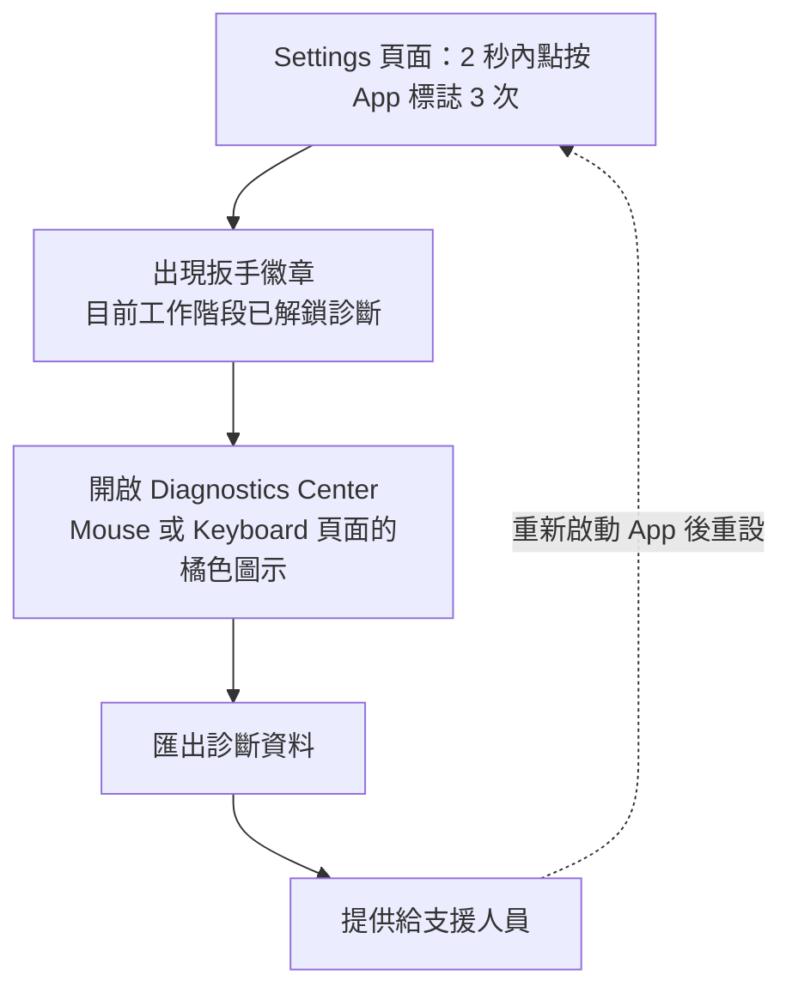

import ThemedImage from '@theme/ThemedImage';
import useBaseUrl from '@docusaurus/useBaseUrl';

完整的診斷資料能大幅縮短問題處理時間。

## 如何在正式版本啟用診斷 {#how-to-enable-diagnostics-in-release-build}

### 從設定解鎖目前工作階段 {#session-unlock-from-settings}

1. 開啟 LinguaX，進入 **Settings**（設定）頁面。
2. 在 **2 秒內點按 App 標誌至少 3 次**。
3. 標誌出現扳手徽章時，代表目前工作階段已啟用診斷。
4. 前往 Mouse 或 Keyboard 頁面，點按橘色手指圖示開啟 **Diagnostics Center**（診斷中心），匯出診斷資料後提供給支援人員。

注意事項：

- 工作階段解鎖是**暫時性**的，重新啟動 App 後會重設。
- 無須執行終端機指令。
- 舊版的終端機切換方式已淘汰，在較新的 macOS 環境中可能無法穩定運作。

<ThemedImage
  alt={"Diagnostics Center 診斷中心：執行更新前"}
  sources={{
    light: useBaseUrl('/img/linguax-diagnostics-before.png'),
    dark: useBaseUrl('/img/linguax-diagnostics-before-dark.png'),
  }}
  width="256"
/>

<ThemedImage
  alt={"Diagnostics Center 診斷中心：執行更新後"}
  sources={{
    light: useBaseUrl('/img/linguax-diagnostics-after.png'),
    dark: useBaseUrl('/img/linguax-diagnostics-after-dark.png'),
  }}
  width="256"
/>

## 需要收集的資料 {#what-to-collect}

- LinguaX 版本。
- macOS 版本。
- 發生問題的 App／瀏覽器名稱。
- 發生問題的網域（若與網站規則有關）。
- 問題發生時間。
- 預期行為與實際行為的具體差異。
- 精簡的重現步驟。

## 重現範本 {#reproduction-template}

1. 開啟「某個 App 或網站」。
2. 從「情境 A」切換到「情境 B」。
3. 實際結果：「發生的行為」。
4. 預期結果：「應該發生的行為」。

## 規則快照清單 {#rule-snapshot-checklist}

提交問題前，請記錄：

- 預期觸發的 App 規則。
- 預期觸發的網域規則（若有）。
- 任何範圍較廣或互相重疊的規則。

## 建議附上的證據 {#evidence-to-attach}

- 相關規則設定的螢幕截圖。
- 簡短的螢幕錄影。
- App 內顯示的完整錯誤文字。

請避免分享敏感個人資料。

## 聯絡支援前的基本驗證 {#minimal-validation-before-contacting-support}

1. 重新啟動 LinguaX。
2. 測試一項簡化後的規則。
3. 重新測試原本的情境。

若問題仍持續，請提供收集好的診斷資料。

## 回饋獎勵政策 {#feedback-reward-policy}

若你的回饋獲採納並隨版本發布，LinguaX 將贈送一年授權。

## 相關文件 {#related-docs}

- [滑鼠問題](/zh-Hant/docs/troubleshooting/mouse-issues)
- [常見問題排解](/zh-Hant/docs/troubleshooting/common-issues)
- [macOS 權限](/zh-Hant/docs/troubleshooting/permissions-on-macos)
- [與其他工具的衝突](/zh-Hant/docs/troubleshooting/conflicts-with-other-tools)
