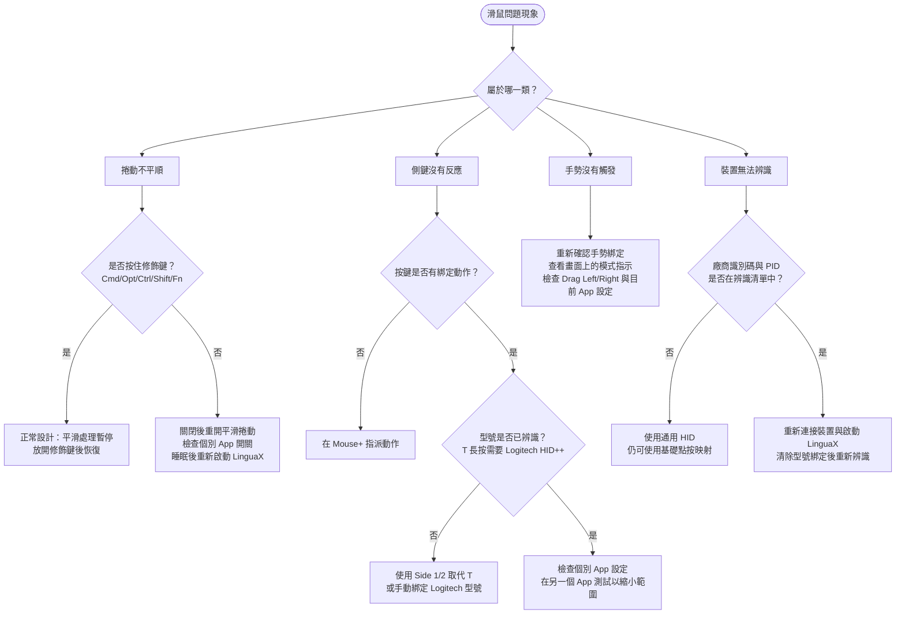

# 滑鼠問題 {#mouse-issues}

Mouse+ 滑鼠增強是 LinguaX 的核心能力之一。本頁依現象整理常見滑鼠問題，請按**現象 → 檢查 → 修正**的順序處理。

若看起來與權限有關，請先參閱 [macOS 權限](/zh-Hant/docs/troubleshooting/permissions-on-macos)。若同時執行其他滑鼠工具，請先查看[與其他工具的衝突](/zh-Hant/docs/troubleshooting/conflicts-with-other-tools)。

## 捲動不平順或停止運作 {#scrolling-is-not-smooth-or-stops-working}

現象：捲動逐格跳動，或在使用一段時間、睡眠之後停止平滑處理。

檢查：

- 全域平滑捲動已開啟，且問題 App 的個別 **Smooth Scroll** 開關為開啟。
- 問題 App 沒有將平滑捲動關閉的個別覆寫。
- 已授予 **Accessibility**（輔助使用）與 **Input Monitoring**（輸入監控）權限；平滑捲動需要事件攔截能力。
- 你使用的是滑鼠滾輪；觸控式軌跡板捲動會刻意原樣傳遞。

修正：

1. 將平滑捲動關閉再開啟一次。
2. 確認目前 App 的 **Smooth Scroll** 開關沒有關閉平滑處理。Min Step／Speed Gain／Duration 與反轉方向開關都是全域設定，只有 Smooth Scroll 啟用狀態可依 App 設定。
3. 若在睡眠喚醒後停止運作，請重新啟動 LinguaX，讓事件攔截與 HID 服務重新初始化。
4. 在簡單 App（例如 Finder 或「文字編輯」）重新測試，確認基本功能正常。
5. 按住修飾鍵（`⌘⌥⌃⇧` 或 Fn）時，平滑處理會依設計暫停，放開後即恢復。

## 側鍵沒有反應 {#side-buttons-do-not-respond}

現象：按下側鍵或拇指鍵沒有動作，或只在部分 App 中有效。

檢查：

- 按鍵已在映射中指派動作。
- 滑鼠型號已正確辨識，詳見下方裝置辨識章節。
- 沒有個別 App 手勢覆寫攔截或清除目前 App 的映射。

修正：

1. 開啟按鍵映射，確認側鍵已有動作。
2. 檢查目前 App 是否有手勢覆寫，必要時調整或移除。
3. 對於拇指鍵（`T` 槽位），請確認裝置已辨識；拇指鍵長按依賴 Logitech HID++，需要支援且已辨識的 Logitech 型號。
4. 在另一個 App 測試相同按鍵，確認是全域問題還是特定 App 問題。

## 手勢沒有觸發 {#gestures-do-not-trigger}

現象：滑動、長按或持續按住修飾鍵的手勢不穩定，或完全沒有觸發。

檢查：

- 該按鍵已設定手勢。
- 操作時間與方向符合手勢需求：長按需要持續按住，滑動需要清楚的方向。
- 目前 App 的手勢覆寫沒有改變預期的綁定。

修正：

1. 重新確認該按鍵的手勢映射。
2. 滑動手勢請清楚地朝指定方向拖曳，並觀察畫面上的模式指示。
3. Modifier Hold 會在按住滑鼠按鍵時模擬 **Fn（地球）**鍵，放開即解除，例如用於按住說話聽寫。目前此動作只開放 Fn。
4. 若水平拖曳動作與預期相反，請檢查 Drag Left／Drag Right 的動作綁定，以及目前 App 的手勢覆寫。滾輪反轉開關不是按鍵拖曳手勢的方向設定；滾輪傾斜槽位 `WL`／`WR` 僅支援 Click。

## 指標速度不正確或重設 {#pointer-speed-is-wrong-or-resets}

現象：指標太快、太慢，或切換滑鼠後速度重設。

檢查：

- 指標速度依裝置儲存，每個滑鼠有自己的設定。
- 目前作用中的裝置確實是要調整的滑鼠。

修正：

1. 讓有問題的滑鼠成為作用中裝置，再調整 Pointer Speed；變更立即生效，不需重新啟動。
2. 若使用多個滑鼠，確認各裝置的速度設定符合需求。同型號且 VID:PID 相同的裝置共用設定。
3. 若速度似乎卡住，請重新啟動 LinguaX，重新套用底層速度設定。

## 裝置無法辨識 {#device-not-recognized}

現象：無法偵測滑鼠，或已知型號未出現自動按鍵映射。

檢查：

- 滑鼠已透過藍牙、接收器或有線方式連接。
- Logitech 無線裝置已配對且處於喚醒狀態，才能進行 BLE HID++ 辨識。
- 先前使用的 **Clear model binding**（清除型號綁定）可能已重設辨識。

修正：

1. 確認裝置出現在清單中；藍牙滑鼠請檢查電量與連線。
2. 喚醒滑鼠，等待裝置清單重新整理；連線時會自動更新。
3. 若辨識為錯誤型號，請在裝置設定使用 **Clear model binding**，再重新連接。
4. 支援型號請參閱[裝置相容性](/zh-Hant/docs/mouse-plus/device-compatibility)。

## 睡眠喚醒後映射失效 {#mappings-fail-after-sleepwake}

現象：Mac 從睡眠喚醒後，按鍵、手勢或平滑捲動停止運作。

檢查：

- 藍牙裝置在喚醒後可能需要一點時間重新連線。
- 長時間使用時，事件攔截可能逾時。

修正：

1. 喚醒後等待幾秒，讓藍牙裝置自動恢復。
2. 若未恢復，請重新啟動 LinguaX，重新整理權限狀態與重要服務。
3. 確認喚醒後仍已授予 **Accessibility** 與 **Input Monitoring** 權限。

## 仍未解決？ {#still-not-resolved}

如果特定滑鼠問題持續發生，請收集診斷資料並聯絡支援人員。

## 相關文件 {#related-docs}

- [macOS 權限](/zh-Hant/docs/troubleshooting/permissions-on-macos)
- [與其他工具的衝突](/zh-Hant/docs/troubleshooting/conflicts-with-other-tools)
- [記錄與診斷](/zh-Hant/docs/troubleshooting/logs-and-diagnostics)
- [Mouse+ 概覽](/zh-Hant/docs/mouse-plus/overview)
