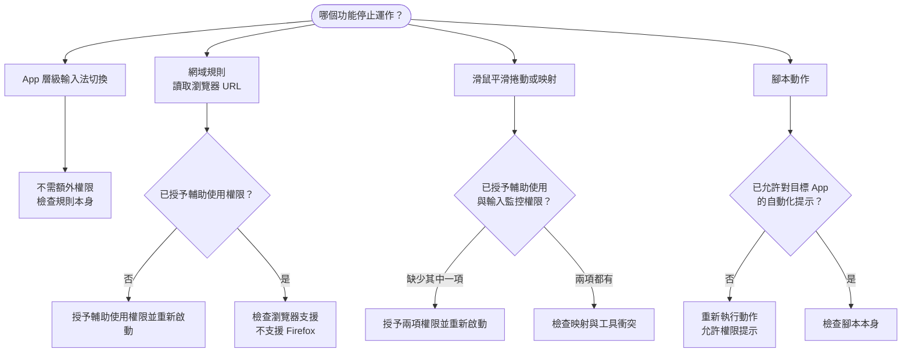

LinguaX 的部分情境偵測與自動化功能，需要對應的 macOS 權限。

## 常見現象 {#common-symptoms}

- 切換 App 後輸入法沒有改變，需先檢查規則；App 層級切換本身不需要輔助使用權限。
- 瀏覽器中的網域規則不穩定。
- 快速鍵腳本動作在首次執行時失敗。

LinguaX 設定頁面主要列出以下兩項 macOS 權限：

## 所需權限 {#required-permissions}

- **Accessibility**（輔助使用）：用於滑鼠事件攔截、平滑捲動、指標速度、按鍵模擬，以及讀取瀏覽器目前分頁的 URL 以套用網站規則。
- **Input Monitoring**（輸入監控）：用於 HID 裝置管理。

> App 層級的輸入法切換不需要輔助使用權限；**網站**網域規則需要讀取瀏覽器 URL，因此需要輔助使用權限。

## 必要檢查 {#required-checks}

1. 開啟 LinguaX 的權限狀態。
2. 開啟 macOS「**系統設定**」，確認已啟用所需權限。
3. 變更權限後重新啟動 LinguaX。

## 關於腳本動作的權限提示 {#about-script-action-prompts}

腳本動作控制 App（例如 System Events 或 Finder）時，macOS 可能另外要求「自動化」權限。

允許這些提示後，對應動作才能運作。

## 恢復流程 {#recovery-flow}

1. 結束 LinguaX。
2. 重新開啟 LinguaX。
3. 重新授予缺少的權限。
4. 測試一項 App 規則。
5. 測試一項網域規則。
6. 若使用腳本動作，請再執行一次內建範本。

## 更新後注意事項 {#post-update-note}

近期版本包含儲存架構升級。更新後首次啟動時，資料移轉可能需要較多時間，完成後各功能才會恢復正常。

## 相關文件 {#related-docs}

- [首次啟動](/zh-Hant/docs/getting-started/first-run)
- [滑鼠問題](/zh-Hant/docs/troubleshooting/mouse-issues)
- [常見問題排解](/zh-Hant/docs/troubleshooting/common-issues)
- [快速鍵與熱鍵](/zh-Hant/docs/concepts/shortcut-and-hotkeys)
